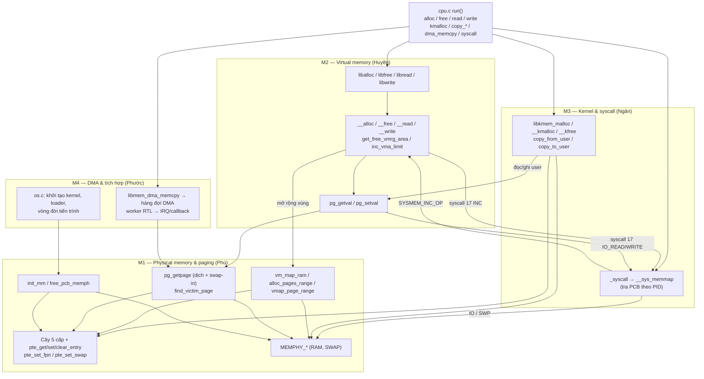
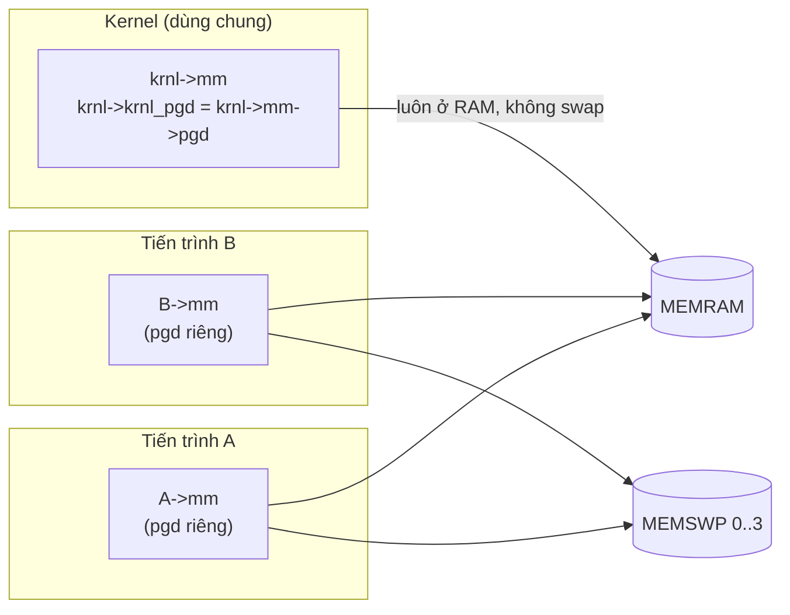
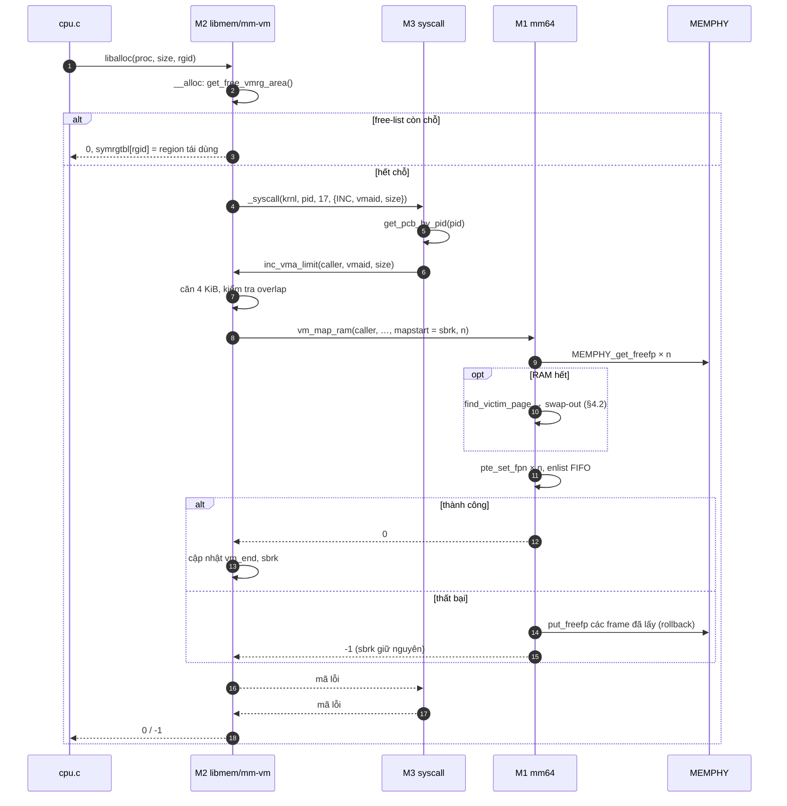
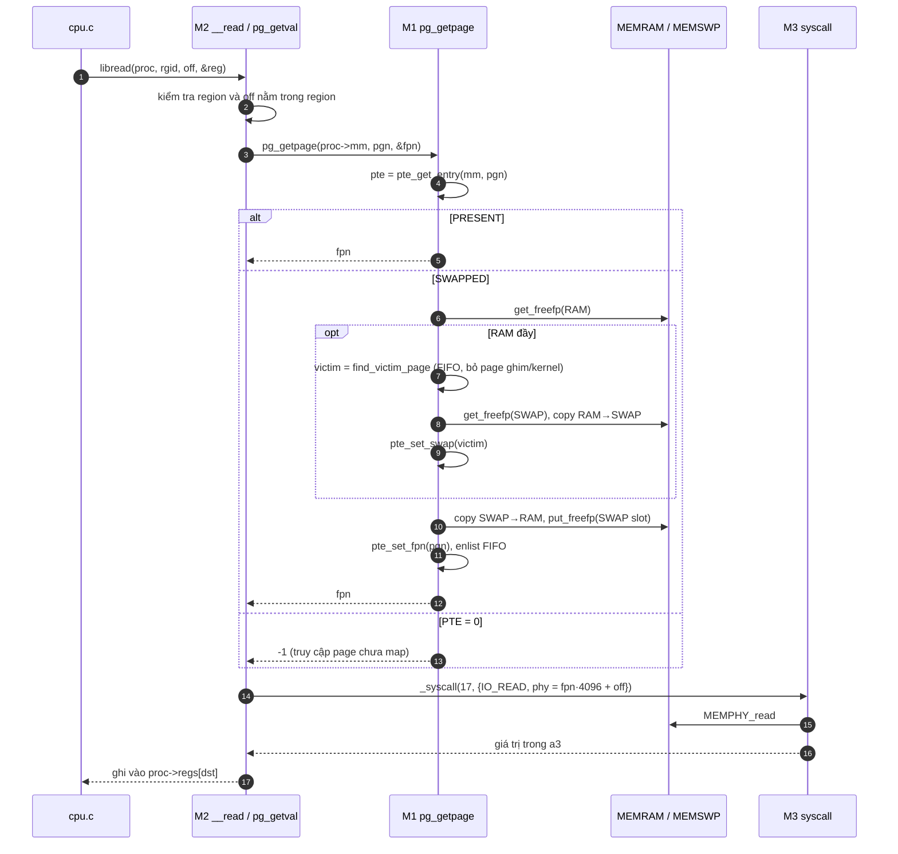
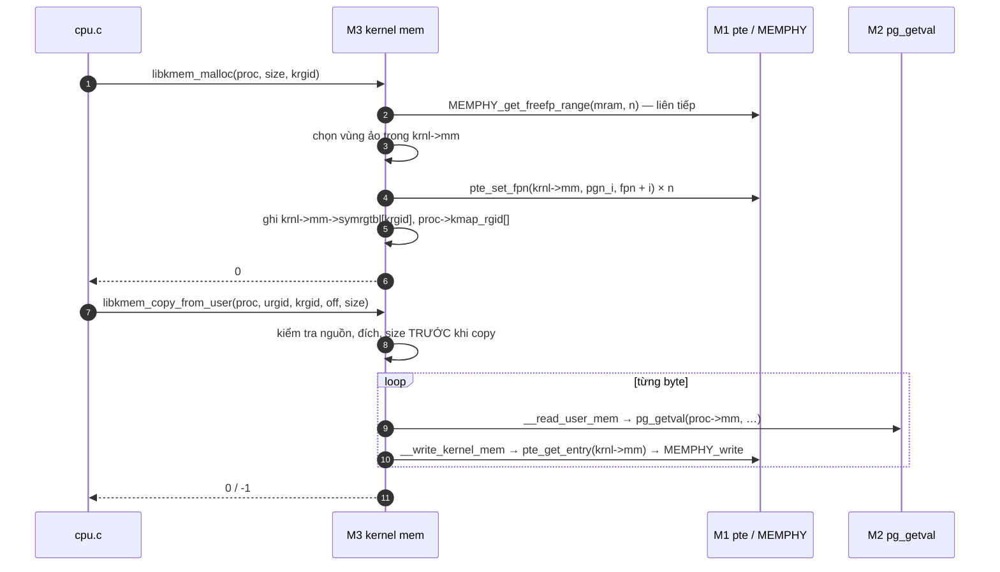
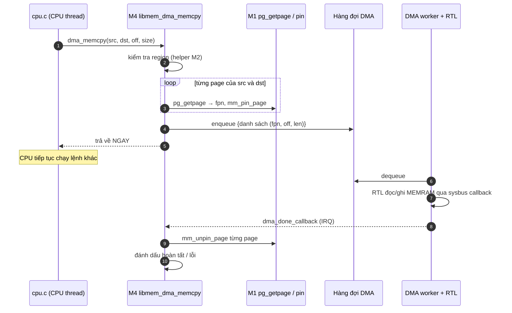
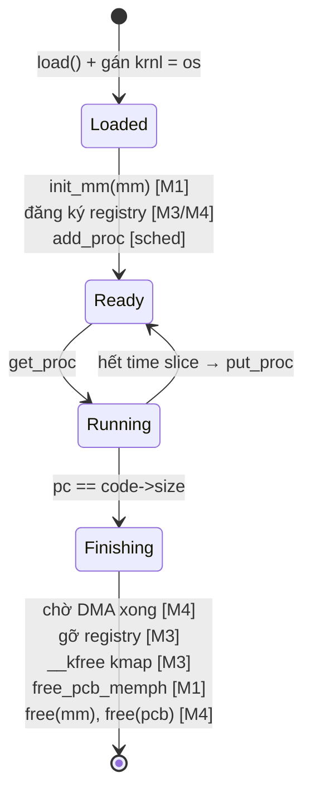
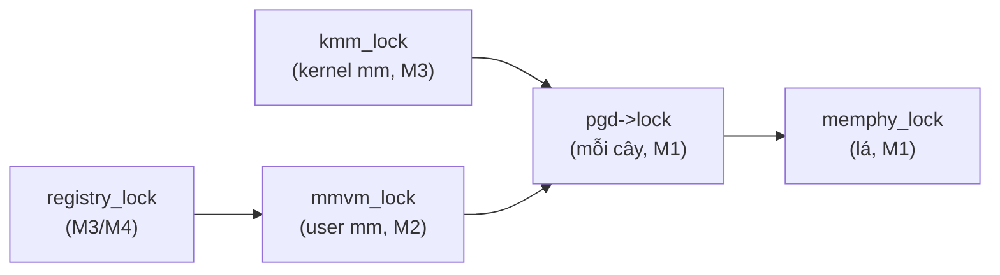

# API Contract giữa các module (MM64)

Tài liệu này mô tả **ai gọi ai, truyền gì, được đảm bảo gì** giữa 4 module.
Mục đích: mỗi người code phần của mình độc lập mà vẫn ghép được.

Ký hiệu trạng thái: ✅ đã chạy được · 🚧 có khung/làm dở · ⛔ chưa có ·
**[ĐỀ XUẤT]** = thay đổi chưa có trong code, cần nhóm chốt.

> Sơ đồ dùng Mermaid — xem được trực tiếp trên GitHub hoặc VS Code
> (Markdown Preview / extension *Markdown Preview Mermaid Support*).

| Module | Người | File chính |
|---|---|---|
| M1 — Physical memory & paging | Phú | `mm-memphy.c`, `mm64.c`, nhóm paging trong `libmem.c` |
| M2 — Virtual memory & user API | Huyền | `mm-vm.c`, nhóm user trong `libmem.c` |
| M3 — Kernel memory & syscall | Ngân | `sys_mem.c`, `syscall.c`, `libstd.c`, nhóm kernel trong `libmem.c` |
| M4 — DMA & tích hợp | Phước | `os.c`, `cpu.c`, `timer.c`, `sysbus.c`, `dpi_rtl.cpp`, `libmem_dma_memcpy()` |

---

## 1. Bức tranh tổng thể

Mũi tên = "gọi vào". Module ở dưới **không bao giờ** gọi ngược lên module ở trên.



**Ý tưởng chính:** M1 là tầng thấp nhất, chỉ biết `mm`, `pgn`, `fpn`. M2 biết
*region/VMA* (địa chỉ nào hợp lệ). M3 biết *PID và kernel space*. M4 nối mọi thứ lại
và lo vòng đời.

---

## 2. Quy ước chung (mọi module phải theo)

### 2.1 Kiểu dữ liệu

| Kiểu | Ý nghĩa | Ghi chú |
|---|---|---|
| `addr_t` | địa chỉ ảo / vật lý, `uint64_t` | **Không** dùng `int` cho địa chỉ hay `pgn` (pgn MM64 rộng 45 bit). |
| `mm_pte_t` | 1 PTE lá, `uint32_t` | Chỉ M1 đọc/ghi trực tiếp; module khác dùng `pte_*`. |
| `struct pt_pgd *` | gốc cây trang | Opaque — chỉ `mm64.c` biết bên trong. **Cấm** `mm->pgd[i]`. |
| `pgn` | page number = `vaddr >> 12` | |
| `fpn` | frame number trong một thiết bị MEMPHY | Frame 0 **hợp lệ**. |

### 2.2 Macro địa chỉ MM64 — [ĐỀ XUẤT] thêm vào `mm64.h`

Hiện code M2/M3 đang dùng nhầm macro **32-bit** (`PAGING_PGN` = page 256 B,
`PAGE_SIZE` = 1024 từ `common.h`). Trong MM64 bắt buộc dùng:

```c
#define PAGING64_PGN(addr)        ((addr_t)(addr) >> 12)          /* page number  */
#define PAGING64_OFFST(addr)      ((addr_t)(addr) & 0xFFF)        /* offset 0..4095 */
#define PAGING64_PHYADDR(fpn,off) (((addr_t)(fpn) << 12) | (off)) /* địa chỉ trong MEMPHY */
/* PAGING64_PAGESZ = 4096, PAGING64_PAGE_ALIGNSZ(sz) đã có sẵn */
```

### 2.3 Mã lỗi

- Hàm trả `int`: **`0` = thành công, `< 0` = thất bại**.
- Hàm trả `addr_t` (unsigned!) như `vm_map_ram`, `alloc_pages_range`:
  **[ĐỀ XUẤT]** đổi sang `int` và trả địa chỉ qua tham số ra. Với `addr_t`,
  phép so sánh `ret < 0` luôn sai — lỗi đang có trong `vm_map_ram`.
- **Thất bại thì không để lại trạng thái dở dang** (không frame mồ côi, không
  PTE nửa vời, không đổi `sbrk`).
- Lỗi phải được truyền ngược lên tới `cpu.c` — không nuốt lỗi.

### 2.4 Hai không gian địa chỉ



- Cùng một địa chỉ ảo ở A và B → hai cây khác nhau → frame khác nhau.
- `pte_*`, `pg_getpage` **luôn dùng tham số `mm` được truyền vào**, không tự lấy
  `caller->mm` hay `krnl->mm`.
- `krnl_pgd` chỉ là bí danh (borrowed alias), **không** cấp phát/giải phóng riêng.
- READ/WRITE thường chỉ đi qua `caller->mm`; muốn chạm kernel phải qua `copy_*`.
- Layout chi tiết (vùng small/medium/large kiểu macOS, kernel base) do M2/M3 chốt;
  M1 yêu cầu địa chỉ **canonical**: bit 56–63 của VA toàn 0 (user, tối đa 64 PB)
  hoặc toàn 1 (kernel, từ `0xFF00_0000_0000_0000`). Chi tiết: `STAGE_1_PAGETABLE.md`.

---

## 3. Contract từng module

### 3.1 M1 — Physical memory & paging (Phú)

#### MEMPHY ✅

| Hàm | Ai gọi | Đảm bảo |
|---|---|---|
| `init_memphy(mp, size, rdm)` | M4 (`os.c main`) | `size = 0` → thiết bị rỗng, hợp lệ (0 frame). Không gọi lại trên thiết bị đang sống. |
| `MEMPHY_get_freefp(mp, &fpn)` | M1 | Lấy 1 frame; hết frame → `-1`, không đổi gì. |
| `MEMPHY_get_freefp_range(mp, n, &fpn)` / `MEMPHY_get_freefp_contig` | M3 (`__kmalloc`) | Lấy **n frame liên tiếp** nguyên khối hoặc không lấy gì. |
| `MEMPHY_put_freefp(mp, fpn)` | M1, M3 | Trả frame; trả 2 lần / frame chưa cấp → `-1`. |
| `MEMPHY_read/write(mp, addr, …)` | M1, M3 (syscall IO), M4 | `addr` ngoài `[0, maxsz)` → `-1`. Thread-safe (lock lá). |
| `MEMPHY_dump(mp)` | debug | In thống kê frame và vài byte đầu. |

> Giới hạn RAM: FPN 16 bit → tối đa 65536 frame × 4 KiB = **256 MiB** (xem §6).
> `os.c` chặn config lớn hơn trước khi gọi `init_memphy`.

#### Bảng trang (Stage 1 ✅ — xem `STAGE_1_PAGETABLE.md`)

| Hàm | Ai gọi | Precondition | Postcondition |
|---|---|---|---|
| `mm64_pgd_create(mm)` / `mm64_pgd_destroy(mm)` ✅ | M1 (`init_mm`, `free_pcb_memph`) | create: `mm` chưa có root. destroy: frame/slot đã được trả, không ai dùng cây. | create: root rỗng + mutex. destroy: giải phóng mọi node, `mm->pgd = NULL`. |
| `init_mm(mm, caller)` ✅ | M4 (loader, kernel init) | `mm != NULL`, `mm->pgd == NULL` (vd. vừa `calloc`). `caller` **có thể NULL** (kernel mm). | `mm` được xóa sạch rồi có root, vma0 rỗng tại `PAGING64_USER_VMA0_START` (0x1000) hoặc `PAGING64_KERNEL_VMA0_START` (0xFF00…) khi `caller == NULL`, `vm_mm = mm`, symrgtbl = 0, `fifo_pgn = NULL`. Lỗi → `-1`, không leak. Vị trí cuối cùng do M2/M3 quyết định. |
| `pte_get_entry(mm, pgn, caller)` ✅ | M1, M3 | — | Trả **giá trị** PTE; nhánh cây chưa có → `0` (không cấp phát). |
| `pte_set_fpn(mm, pgn, fpn, caller)` ✅ | M1, M3 | `fpn` đang thuộc RAM, `fpn ≤ 65535` | Tạo node trung gian nếu thiếu; PTE = PRESENT, ¬SWAPPED, FPN. |
| `pte_set_swap(caller, pgn, typ, off)` ✅ (dùng `caller->mm`) | M1 | — | PTE = ¬PRESENT, SWAPPED, typ = id thiết bị swap, off = fpn trong swap. **[ĐỀ XUẤT]** thêm tham số `mm`. |
| `pte_clear_entry(mm, pgn, caller)` ✅ | M1, M3 (`__kfree`) | — | PTE = 0. Không trả frame (người gọi tự trả). |
| `pte_set_entry(mm, pgn, val, caller)` ✅ | M1 | `val` vừa 32 bit | Ghi nguyên giá trị, từ chối nếu `val > UINT32_MAX`. |

#### Mapping, swap, dịch địa chỉ ⛔

| Hàm | Ai gọi | Contract |
|---|---|---|
| `vm_map_ram(caller, astart, aend, mapstart, n, &rg)` | M2 (`inc_vma_limit`) | Map `n` page bắt đầu tại `mapstart` (căn 4 KiB) vào `caller->mm`. Thành công: mọi page PRESENT, nằm trong FIFO, `rg = [mapstart, mapstart + n·4096)`. Thất bại: **rollback** toàn bộ, trả `< 0`. |
| `alloc_pages_range(caller, n, &list)` | M1 nội bộ | Lấy `n` frame RAM; thiếu thì evict victim; không đủ → trả lại hết, `-1`. |
| `vmap_page_range(caller, addr, n, frames, &rg)` | M1 nội bộ | Ghi PTE cho từng page theo danh sách frame. |
| `pg_getpage(mm, pgn, &fpn, caller)` | M2 (`pg_getval/setval`), M4 (DMA) | Page PRESENT → trả `fpn`. Page SWAPPED → swap-in rồi trả `fpn`. PTE = 0 (chưa từng map) → `-1` (lỗi truy cập). **[ĐỀ XUẤT]** đổi `int pgn, int *fpn` thành `addr_t`. |
| `find_victim_page(…)` | M1 nội bộ | Chọn FIFO, bỏ qua page kernel và page **đang bị ghim** (DMA). |
| `vmap_pgd_memset(caller, addr, n)` | M3 (`SYSMEM_MAP_OP`) | Điền mẫu vào PTE của một dải (dùng cho debug/reserve). |
| `free_pcb_memph(caller)` ⛔ | M4 (khi tiến trình kết thúc) | Trả mọi frame RAM + slot SWAP của `caller->mm`, giải phóng mọi node cây, FIFO, VMA, free-list, mutex. **Không** đụng kernel mm. |
| `print_pgtbl(caller, start, end)` ⛔ | M2 (sau alloc/read/write khi bật `PAGETBL_DUMP`) | In các PTE khác 0 trong khoảng, kèm 5 chỉ số. |
| **[ĐỀ XUẤT]** `mm_pin_page / mm_unpin_page(mm, pgn)` | M4 (DMA) | Page bị ghim không được chọn làm victim cho tới khi unpin. |

### 3.2 M2 — Virtual memory & user API (Huyền)

| Hàm | Ai gọi | Contract |
|---|---|---|
| `liballoc(proc, size, rgid)` 🚧 | `cpu.c` | Ghi địa chỉ vào `symrgtbl[rgid]`; ưu tiên tái dùng free-list, hết chỗ thì syscall INC. |
| `libfree(proc, rgid)` 🚧 | `cpu.c` | Region trả về free-list; `rgid` chưa cấp → `-1`. **Không** trả frame (theo spec). |
| `libread(proc, rgid, off, &dst)` / `libwrite(proc, val, rgid, off)` 🚧 | `cpu.c` | Kiểm tra region tồn tại và `off` nằm trong region trước khi gọi `pg_getval/setval`. |
| `inc_vma_limit(caller, vmaid, inc_sz)` ⛔ | M3 (`SYSMEM_INC_OP`) | Căn `inc_sz` lên bội 4096, kiểm tra overlap/tràn số, gọi `vm_map_ram`. **Chỉ** tăng `vm_end`/`sbrk` khi map thành công. |
| `pg_getval / pg_setval(mm, addr, …)` ⛔ | M2, M3 (`__read/__write_user_mem`) | `pgn = PAGING64_PGN(addr)` → `pg_getpage` → `phy = PAGING64_PHYADDR(fpn, off)` → syscall `IO_READ/IO_WRITE`. |
| `get_vma_by_num`, `validate_overlap_vm_area`, `INCLUDE/OVERLAP` 🚧 | M1, M2, M3 | `get_vma_by_num` đi hết danh sách mà không thấy → `NULL` (hiện có thể dereference NULL). |

### 3.3 M3 — Kernel memory & syscall (Ngân)

| Hàm | Ai gọi | Contract |
|---|---|---|
| `_syscall(krnl, pid, nr, regs)` ✅ | `libsyscall`, M2 | Truyền **PID**, không truyền PCB. Trả mã lỗi của handler. |
| `__sys_memmap(krnl, pid, regs)` 🚧 | `_syscall` (nr 17) | Tra PCB qua `get_pcb_by_pid`. PID không tồn tại → `-1`. Mỗi `memop` trả nguyên mã lỗi của hàm bên dưới. |
| `libkmem_malloc / __kmalloc` 🚧 | `cpu.c` | Lấy frame **liên tiếp** (`MEMPHY_get_freefp_range`), map vào **kernel mm** bằng `pte_set_fpn`. Page kernel **không** vào FIFO. Lỗi giữa chừng → trả frame + xóa PTE đã ghi. |
| `__kfree` 🚧 | M3, M4 (khi tiến trình kết thúc) | `pte_get_entry` → `MEMPHY_put_freefp` → `pte_clear_entry`. |
| `copy_from_user / copy_to_user` 🚧 | `cpu.c` | Kiểm tra **cả nguồn, đích và size** trước khi copy byte đầu tiên. |
| `__read/__write_kernel_mem`, `__read/__write_user_mem` 🚧 | M3, M4 | Kernel: qua `krnl->mm`. User: qua `pg_getval/setval` của `caller->mm`. |

**Bảng `sys_memmap` (syscall 17):**

| `a1` (memop) | `a2` | `a3` | Handler | Module sở hữu handler |
|---|---|---|---|---|
| `SYSMEM_MAP_OP` = 1 | addr | số page | `vmap_pgd_memset` | M1 |
| `SYSMEM_INC_OP` = 2 | vmaid | inc_sz | `inc_vma_limit` | M2 |
| `SYSMEM_SWP_OP` = 3 | src fpn (RAM) | dst fpn (SWAP) | `__mm_swap_page` | M1 |
| `SYSMEM_IO_READ` = 4 | phy addr | ← giá trị đọc (out) | `MEMPHY_read` | M1 |
| `SYSMEM_IO_WRITE` = 5 | phy addr | giá trị | `MEMPHY_write` | M1 |

### 3.4 M4 — DMA & tích hợp (Phước)

| Hàm / điểm tích hợp | Contract |
|---|---|
| `main` / `ld_routine` (os.c) | Thứ tự khởi tạo: MEMPHY → registry → **kernel mm (`init_mm(os.mm, NULL)`) → `os.krnl_pgd = os.mm->pgd`** → DMA → scheduler → loader/CPU. |
| Loader | `proc->krnl = &os` → `proc->mm = calloc` → `init_mm(proc->mm, proc)` → đăng ký registry → `add_proc`. |
| Tiến trình kết thúc (`cpu_routine`) | Chờ DMA của tiến trình xong → gỡ registry → `__kfree` từng `kmap_rgid` → `free_pcb_memph` → `free(mm)` → `free(pcb)`. |
| `libmem_dma_memcpy(caller, src, dst, off, size)` ⛔ | Kiểm tra region/offset/size (dùng helper của M2), **ghim** các page, đẩy yêu cầu vào hàng đợi, **trả về ngay**. Callback hoàn tất: unpin, báo trạng thái. |
| `cpu.c` READ | Ghi kết quả vào **thanh ghi đích** `proc->regs[arg_2]` (hiện đang ghi vào `&ins.arg_2`). |

---

## 4. Các luồng chính (sequence)

### 4.1 `alloc` — cần mở rộng vùng nhớ



### 4.2 `read` / `write` — page có thể đang ở SWAP



### 4.3 `kmalloc` và `copy_from_user`



### 4.4 DMA bất đồng bộ



### 4.5 Vòng đời tiến trình



---

## 5. Sở hữu tài nguyên và khóa

### 5.1 Ai cấp, ai giải phóng

| Tài nguyên | Cấp bởi | Giải phóng bởi | Khi nào |
|---|---|---|---|
| `struct memphy_struct` (RAM/SWAP) | M4 `main` | M4 | cuối chương trình |
| Frame RAM của user | M1 `alloc_pages_range` | M1 `free_pcb_memph` | tiến trình kết thúc |
| Slot SWAP | M1 swap-out | M1 swap-in / `free_pcb_memph` | |
| Node cây trang user | M1 walker (lazy) | M1 `free_pcb_memph` | tiến trình kết thúc |
| `proc->mm` | M4 loader (`calloc`) | M4 (`free`) **sau** `free_pcb_memph` | |
| VMA, free-region list | M1 `init_mm` / M2 | M1 `free_pcb_memph` | |
| Frame + PTE kernel | M3 `__kmalloc` | M3 `__kfree` | kfree hoặc tiến trình kết thúc |
| `os.mm`, cây kernel | M4 gọi `init_mm` | không giải phóng (sống tới hết) | |
| PCB | M4 loader | M4 | sau toàn bộ cleanup |

### 5.2 Thứ tự khóa — tránh deadlock



Quy tắc:
1. Chỉ được khóa theo chiều mũi tên; **không bao giờ** khóa ngược.
2. `mmvm_lock` và `kmm_lock` là mutex **không đệ quy**. `__alloc`, `__read`, `__write`
   đã giữ `mmvm_lock` khi gọi xuống M1 → hàm của M1 **không được** khóa lại
   `mmvm_lock`.
3. `memphy_lock` là khóa lá: đang giữ nó thì không gọi hàm nào khác có khóa.
4. Không giữ bất kỳ khóa nào trong khi **chờ** DMA hoàn tất.
5. Cần đọc user memory trong khi đang giữ `kmm_lock` (copy_*) → chấp nhận được vì
   `kmm_lock → mmvm_lock` không xuất hiện ngược lại ở đâu. Nếu thêm luồng mới thì
   phải kiểm tra lại sơ đồ này.

---

## 6. Định dạng PTE (32 bit) — MM64 dùng FPN 16 bit

```
Page đang ở RAM (PRESENT=1, SWAPPED=0)
 31  30  29  28  27 ──────────────── 16  15 ──────────────────── 0
┌───┬───┬───┬───┬──────────────────────┬──────────────────────────┐
│ P │ S │ R │ D │ FLAGS (12 bit, M1    │      FPN (16 bit)        │
│ 1 │ 0 │   │   │  dành cho cờ sau này)│  0..65535 → 256 MiB RAM  │
└───┴───┴───┴───┴──────────────────────┴──────────────────────────┘

Page đang ở SWAP (PRESENT=0, SWAPPED=1) — không đổi so với spec
 31  30  29  28  27 ── 26  25 ──────────────── 5  4 ────── 0
┌───┬───┬───┬───┬─────────┬─────────────────────┬──────────┐
│ 0 │ 1 │ R │ D │ (trống) │ SWP offset (21 bit) │ SWP type │
└───┴───┴───┴───┴─────────┴─────────────────────┴──────────┘
  SWP type  = chỉ số thiết bị swap (0..3)
  SWP offset = fpn trong thiết bị swap (tối đa 8 GiB mỗi thiết bị)
  R (bit 29) = [ĐỀ XUẤT] cờ "ghim" cho DMA
  PTE = 0    = page chưa từng được map
```

- Spec vẽ FPN bit 0–12, bit 13–14 "zero", bit 15–27 "user-defined". Trong MM64
  nhóm mở rộng FPN sang bit 13–15 (vùng spec để cho phần cài đặt tự quyết) →
  **RAM tối đa 256 MiB**, đúng với config `os_0/os_1_mlq_paging`. Nhánh 32-bit cũ
  giữ nguyên 13 bit.
- Bit 16–27 là vùng cờ của M1 (ACCESSED, PINNED…) — **module khác không dùng**.
- Mọi module đọc FPN qua `PAGING_FPN(pte)` nên tự động theo độ rộng mới.
- `os.c` chặn RAM > `PAGING64_MAX_RAMSZ` (256 MiB) và SWAP > `PAGING64_MAX_SWPSZ`
  (8 GiB) kèm cảnh báo. Chi tiết: `STAGE_2_INIT_MM.md`.

---

## 7. Việc cần chốt (checklist cho nhóm)

- [ ] Thêm macro `PAGING64_PGN / PAGING64_OFFST / PAGING64_PHYADDR`; M2, M3 bỏ `PAGING_PGN`, `PAGE_SIZE` cũ.
- [ ] Đổi kiểu trả về của `vm_map_ram` / `alloc_pages_range` sang `int`; `pg_getpage` dùng `addr_t`.
- [ ] FIFO victim **theo tiến trình** hay **toàn cục** trong `krnl`. M1 đề xuất **toàn cục**: test RAM nhỏ có 8 tiến trình chung 1 frame.
- [ ] Vị trí và kích thước vma0 cùng layout kiểu macOS (M2/M3), base của kernel space.
- [ ] Cơ chế ghim frame cho DMA (bit 29 hay cờ riêng) và API `mm_pin_page / mm_unpin_page`.
- [x] `os.c`: `os.krnl_pgd = os.mm->pgd` sau `init_mm(os.mm, NULL)` (Stage 2).
- [x] FPN mở rộng 16 bit (256 MiB), `os.c` chặn config lớn hơn (Stage 2).
- [ ] Thứ tự cleanup khi tiến trình kết thúc (§4.5) và chờ DMA trước khi free.
