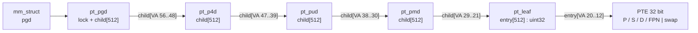

# Stage 1 — Cây bảng trang 5 cấp và PTE API (Module 1)

Phạm vi: tạo/hủy root, walker 2 chế độ, `init_pte`, `pte_get_entry`,
`pte_set_entry`, `pte_set_fpn`, `pte_set_swap`, `pte_clear_entry`.
Chưa làm (tại thời điểm Stage 1): `init_mm` (đã xong ở Stage 2, xem `STAGE_2_INIT_MM.md`), mapping (`vm_map_ram`…), swap (`pg_getpage`…), cleanup
(`free_pcb_memph`), `print_pgtbl` — xem §6.

| File | Thay đổi |
|---|---|
| `src/mm64.c` | Cài đặt cây + PTE API (phần đầu file, trước `vmap_pgd_memset`) và `pte_clear_entry`. |
| `include/mm64.h` | Khai báo public `mm64_pgd_create`, `mm64_pgd_destroy`. |
| `tests/test_mm64_pt.c` | Unit test (9 nhóm). |
| `tests/run_mm64_pt_tests.sh` | Script build + chạy test. |

Không đổi chữ ký nào trong `mm.h` (đã được khóa bởi `tests/check_mm64_types.py`, vẫn PASS).

---

## 1. Cấu trúc dữ liệu



- Node nằm trên heap của host, **tạo khi cần** (`calloc`, sẵn toàn 0).
  Con trỏ con `NULL` = cả dải bên dưới chưa map. PTE `0` = page chưa map.
- Kích thước: leaf 2 KiB, các tầng giữa 4 KiB, root 4 KiB + mutex.
  Map page đầu tiên tốn root + 4 node ≈ 18 KiB; mỗi dải 2 MiB mới thêm 2 KiB.
- Mỗi `mm` có cây riêng → cùng `pgn` ở hai tiến trình là hai PTE khác nhau.
  Kernel dùng cây của `os.mm` (bí danh `krnl_pgd`).

### Quy tắc địa chỉ canonical

`pgn = vaddr >> 12`. Địa chỉ 57 bit là canonical khi **bit 56..63 của VA
bằng nhau**:

| Nửa | Dải VA | `pgn >> 44` | Chỉ số PGD |
|---|---|---|---|
| User | `0x0000_0000_0000_0000` – `0x00FF_FFFF_FFFF_FFFF` (64 PB) | `0` | 0 – 255 |
| Kernel | `0xFF00_0000_0000_0000` – `0xFFFF_FFFF_FFFF_FFFF` | `0xFF` | 256 – 511 |

Mọi `pgn` khác (vd. VA `0x0100_0000_0000_0000`) bị từ chối. Hệ quả: page user
và page kernel không bao giờ trùng nhánh PGD, kể cả khi lỡ nằm chung một cây.

### Khóa

Mỗi cây có `pgd->lock`. Mỗi lời gọi `pte_*` khóa đúng một lần trong lúc đi
xuống cây rồi mở. Thứ tự toàn hệ thống:
`mmvm_lock / kmm_lock → pgd->lock → memphy_lock`. `pte_*` không gọi MEMPHY và
không đụng `mmvm_lock`, nên gọi được khi người gọi đang giữ `mmvm_lock`.

> Mỗi `pte_*` là nguyên tử riêng lẻ. Chuỗi "đọc PTE → quyết định → ghi PTE"
> (swap) phải được bảo vệ bởi khóa cấp trên (`mmvm_lock`) — việc của Stage 4.

---

## 2. Định dạng PTE (không đổi so với spec)

```
Present : P=1 S=0 | D(28) | FPN bits 15..0            → tối đa 65536 frame = 256 MiB
          (Stage 2 mở rộng từ 13 bit của spec, xem STAGE_2_INIT_MM.md)
Swapped : P=0 S=1 | D(28) | off bits 25..5 | typ 4..0 → typ = id thiết bị swap
Empty   : 0
```

Thay đổi so với code mẫu:
- **Frame 0 hợp lệ** (code cũ từ chối `fpn == 0`, trong khi MEMPHY cấp frame 0 đầu tiên).
- Entry **swapped có PRESENT = 0** (code cũ của `init_pte` bật cả P và S, mâu thuẫn với `pte_set_swap`).
- Giá trị không vừa trường → trả `-1`, **không cắt bit âm thầm**.

---

## 3. Chức năng từng hàm

### Vòng đời cây (public, `mm64.h`)

#### `int mm64_pgd_create(struct mm_struct *mm)`
Tạo root rỗng cho `mm`: `calloc` `pt_pgd` + `pthread_mutex_init`, gán
`mm->pgd`, đặt các field cũ `mm->p4d/pud/pmd/pt = NULL`.
- `-1` nếu `mm == NULL`, `mm` **đã có root** (không ghi đè), hoặc cấp phát/
  khởi tạo mutex lỗi (khi đó `mm` không đổi).
- Người gọi dự kiến: `init_mm()` (Stage 2).

#### `void mm64_pgd_destroy(struct mm_struct *mm)`
Duyệt hậu thứ tự, `free` mọi leaf → PMD → PUD → P4D, hủy mutex, `free` root,
đặt `mm->pgd = NULL`. An toàn với `NULL` và gọi lặp.
- **Chỉ giải phóng node**, không trả frame/slot swap mà PTE trỏ tới — người gọi
  (`free_pcb_memph`, Stage 5) phải trả trước.
- Không thread nào được dùng cây trong và sau lời gọi.

### Nội bộ (`static` trong `mm64.c`)

#### `pgn_is_canonical(pgn)` / `pt_root_for(mm, pgn)`
Kiểm tra quy tắc canonical ở §1; trả root của `mm` hoặc `NULL` nếu `mm`, root
hoặc `pgn` không hợp lệ. Mọi hàm public đi qua đây trước.

#### `mm_pte_t *pt_walk_locked(struct pt_pgd *root, addr_t pgn, int create)`
Trái tim của module. Tách `pgn` thành 5 chỉ số (`get_pd_from_pagenum`) rồi đi
xuống 4 tầng con trỏ, trả **con trỏ tới PTE thật** trong leaf.

| `create` | Gặp con `NULL` | Dùng cho |
|---|---|---|
| `0` (lookup) | trả `NULL`, không cấp phát | `pte_get_entry`, `pte_clear_entry` |
| `1` (create) | `calloc` node mới rồi đi tiếp | `pte_set_*` |

Người gọi phải giữ `root->lock`. Nếu `calloc` lỗi giữa đường: trả `NULL`, các
node đã tạo trước đó được giữ lại (rỗng, vô hại, được `destroy` thu hồi) — lần
thử sau sẽ dùng lại chúng.

### Tách chỉ số

#### `get_pd_from_address(addr, &pgd, &p4d, &pud, &pmd, &pt)`
Tách địa chỉ ảo thành 5 chỉ số 9 bit (PGD 56..48, P4D 47..39, PUD 38..30,
PMD 29..21, PT 20..12). Ví dụ spec `0x39ffe1d9c9000` →
`0x03, 0x13f, 0x1f8, 0x0ec, 0x1c9` (có test).

#### `get_pd_from_pagenum(pgn, …)`
Như trên với đầu vào là `pgn` (dịch trái 12 bit rồi gọi hàm trên).

### PTE API (khai báo trong `mm.h`)

Tham số `caller` của các hàm dưới **không được dùng** (giữ để tương thích);
có thể truyền `NULL`. Luôn dùng `mm` được truyền vào — user mm hoặc kernel mm.

#### `int init_pte(addr_t *pte, int pre, addr_t fpn, int drt, int swp, int swptyp, addr_t swpoff)`
Dựng **toàn bộ** giá trị PTE vào `*pte` (xóa bit cũ):

| Điều kiện | Kết quả |
|---|---|
| `swp != 0` | P=0, S=1, `typ` (0..31), `off` (0..2²¹−1) — `pre` bị bỏ qua |
| `swp == 0`, `pre != 0` | P=1, S=0, FPN (0..65535) |
| cả hai = 0 | `0` (rỗng); `drt` bị bỏ qua |
| `drt != 0` (khi entry khác 0) | bật DIRTY |

Trường không vừa hoặc `pte == NULL` → `-1`, `*pte` giữ nguyên. Hàm thuần túy,
không đụng cây — các `pte_set_*` dùng nó để mã hóa.

#### `addr_t pte_get_entry(mm, pgn, caller)`
Trả **giá trị** PTE (32 bit, mở rộng thành `addr_t`). Đường đi chưa tồn tại,
`pgn` sai, `mm`/root `NULL` → `0` (= chưa map). **Không bao giờ cấp phát**, nên
đọc lung tung không làm cây phình ra.

> Code cũ trả `(addr_t)&pte` — địa chỉ biến cục bộ — nên mọi kiểm tra
> `PAGING_PAGE_PRESENT` ở libmem trước đây đọc giá trị rác.

#### `int pte_set_entry(mm, pgn, uint64_t pte_val, caller)`
Ghi nguyên giá trị thô, tạo bảng còn thiếu. `pte_val > UINT32_MAX`, `mm`/`pgn`
sai, hoặc cấp phát lỗi → `-1` và entry không đổi.

#### `int pte_set_fpn(mm, pgn, fpn, caller)`
Map page vào frame RAM: entry = P=1, S=0, D=0, FPN. `fpn > 65535` → `-1`
(chặn ghi FPN bị cắt bit khi RAM > 256 MiB). Dùng cho: map mới (Stage 3),
swap-in (Stage 4), `__kmalloc` (Module 3, truyền `krnl->mm`).

#### `int pte_set_swap(caller, pgn, swptyp, swpoff)`
Đánh dấu page đã bị swap ra: P=0, S=1, `typ` = id thiết bị swap, `off` = frame
trong thiết bị đó. **Tác động lên `caller->mm`** vì chữ ký cũ không có tham số
`mm`; `caller == NULL` → `-1`.

> Nếu nhóm chọn FIFO victim **toàn cục** (victim có thể thuộc tiến trình khác),
> cần thêm biến thể có tham số `mm` — đã ghi trong `API_CONTRACT.md` §7.

#### `int pte_clear_entry(mm, pgn, caller)`
Đặt entry về `0`. **Không trả frame/slot** — người gọi trả trước (vd.
`__kfree`: `pte_get_entry` → `MEMPHY_put_freefp` → `pte_clear_entry`). Entry
chưa tồn tại → vẫn `0` (thành công) và không cấp phát. Chỉ trả `-1` khi
`mm`/`pgn` không hợp lệ. Bảng rỗng không bị thu gọn — chúng được thu hồi khi
`destroy`.

---

## 4. Kiểm thử

```sh
sh tests/run_mm64_pt_tests.sh                    # Linux: kèm ASan + UBSan
SANITIZERS=none sh tests/run_mm64_pt_tests.sh    # Windows/MinGW (không có ASan)
```

Test link với `--wrap=malloc/calloc/free` để đếm số vùng nhớ còn sống (phát
hiện leak) và giả lập `calloc` lỗi.

| Nhóm test | Kiểm tra |
|---|---|
| root lifecycle | create/destroy, không tạo root thứ hai, NULL-safe, field cũ = NULL, create lỗi khi calloc lỗi |
| init_pte encoding | frame 0, FPN 8191/8192/65535/65536, không tràn sang bit cờ, dirty, swap max/overflow, entry rỗng, `*pte` giữ nguyên khi lỗi |
| get/set/clear/swap | lookup/clear không cấp phát, set tạo đúng 4 node, chặn FPN/PTE quá cỡ, swap ↔ present, mm/pgn không hợp lệ |
| index split (spec) | ví dụ `0x39ffe1d9c9000`, page user cao nhất, page kernel thấp/cao nhất |
| table boundaries | 2 cặp page sát nhau ở mỗi ranh giới: **2 MiB (PT 511↔512)**, **1 GiB**, 512 GiB, 256 TiB, user↔kernel; đúng giá trị, hàng xóm vẫn trống, **đúng số node mỗi tầng**, xóa một bên không ảnh hưởng bên kia |
| two mm, same pgn | hai `mm` cùng `pgn` giữ frame riêng; swap/clear/destroy một bên không ảnh hưởng bên kia |
| allocation failure | `calloc` lỗi ở từng tầng P4D/PUD/PMD/leaf: trả `-1`, entry vẫn 0, không leak, lần sau thành công |
| destroy frees all | 3000 page rải rác (user + kernel, có dãy liên tiếp): đọc đúng, destroy trả hết bộ nhớ |
| concurrent shared tree | 8 thread cùng ghi/đọc một cây (như cây kernel), tranh nhau tạo cùng node: không mất entry, số node bằng bản dựng tuần tự (không tạo trùng/leak) |

Kết quả trên máy dev (MinGW gcc 14.2, `SANITIZERS=none`): **ALL MM64 PAGE-TABLE
TESTS PASSED**. `tests/check_mm64_types.py` (Stage B0) vẫn PASS. Chưa chạy được
với ASan trên Windows — nên chạy lại script mặc định trên Linux/WSL.

`tests/run_memphy_tests.sh` hiện **không build được** do lỗi có sẵn ở
`libmem.c:959` (`free_pcb_memph` dùng `mm->pgd[i]`), sẽ hết khi làm Stage 5.

---

## 5. Lưu ý cho các module khác

- **M2 / M3:** tính `pgn` bằng `vaddr >> 12` (macro MM64), **không** dùng
  `PAGING_PGN` / `PAGE_SIZE` cũ (256 B / 1024 B).
- **M3 (`__kmalloc`, `__kfree`, `__read/__write_kernel_mem`):** truyền
  `caller->krnl->mm` cho `pte_*`; các hàm này đã an toàn khi nhiều CPU cùng gọi.
  Địa chỉ kernel phải nằm ở nửa trên (VA bit 56..63 = 1), nếu không `pte_set_fpn`
  trả `-1`.
- **M4 (`os.c`):** sau `init_mm(os.mm, NULL)` (Stage 2 sẽ tạo root), gán
  `os.krnl_pgd = os.mm->pgd`; bỏ dòng `calloc` ở `os.c:186`.
- `pte_get_entry` trả `0` cho cả "chưa map" và "lỗi tham số" — kiểm tra
  `PAGING_PAGE_PRESENT` / `PAGING_PTE_SWAPPED_MASK` để phân biệt các trạng thái.

---

## 6. Việc tiếp theo

| Stage | Nội dung | Phụ thuộc Stage 1 |
|---|---|---|
| 2 | `init_mm`: gọi `mm64_pgd_create`, tạo vma0, không dùng `caller`; sửa `os.c:186` | `mm64_pgd_create` |
| 3 | `alloc_pages_range`, `vmap_page_range`, `vm_map_ram` có rollback | `pte_set_fpn`, `pte_clear_entry` |
| 4 | `find_victim_page`, `pg_getpage` (swap-out/in) | `pte_get_entry`, `pte_set_swap`, `pte_set_fpn` |
| 5 | `free_pcb_memph`: duyệt leaf, trả frame/slot, rồi `mm64_pgd_destroy` | walker + destroy |
| 6 | `print_pgtbl`, thống kê số node / số lần truy cập cho report | duyệt cây |
