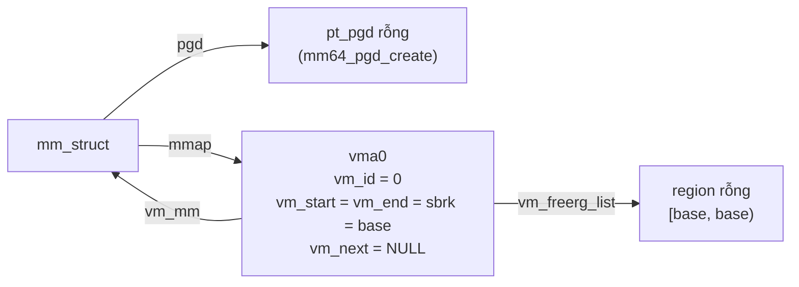

# Stage 2 — FPN 16 bit (RAM 256 MiB) và `init_mm` (Module 1)

| File | Thay đổi |
|---|---|
| `include/mm.h` | MM64: FPN bit 0–15, vùng cờ (USRNUM) bit 16–27. Nhánh 32-bit giữ nguyên. |
| `include/mm64.h` | Hằng số giới hạn `PAGING64_MAX_RAM_FRAMES/RAMSZ/SWP_FRAMES/SWPSZ`; base mặc định của vma0. |
| `src/mm64.c` | `init_mm` hoàn chỉnh; `init_vm_rg` kiểm tra lỗi cấp phát. |
| `src/os.c` | Kernel mm qua `init_mm` + bí danh `krnl_pgd`; kiểm tra lỗi `init_mm`/`init_memphy`; chặn RAM/SWAP quá cỡ. |
| `tests/test_mm64_pt.c` | Test FPN 16 bit và 4 nhóm test `init_mm`. |
| `tests/check_mm64_types.py` | Assertion mask FPN 13 → 16 bit. |

---

## 1. FPN 16 bit — hỗ trợ RAM 256 MiB

### Vấn đề
Config `os_0_mlq_paging`, `os_1_mlq_paging` khai báo RAM 256 MiB, nhưng PTE theo
spec chỉ có FPN 13 bit → 8192 frame × 4 KiB = 32 MiB. Frame thứ 8192 trở đi sẽ bị
cắt bit khi ghi vào PTE → hai page trỏ chung một frame.

### Giải pháp
Spec vẽ PTE của page đang ở RAM như sau: FPN bit 0–12, bit 13–14 "zero if
present", bit 15–27 "user-defined numbering". Không module nào dùng bit 13–27.
Nhóm mở rộng FPN sang bit 13–15 — vùng mà spec để phần cài đặt tự quyết:

```
Spec (32-bit)  : P S R D | USRNUM 27..15 | 0 0 | FPN 12..0   → 32 MiB
MM64 (nhóm)    : P S R D | FLAGS  27..16 |       FPN 15..0   → 256 MiB
Swapped        : P=0 S=1 R D | trống | offset 25..5 | type 4..0   (không đổi)
```

Lý do chọn đúng 16 bit (không lấy hết 28 bit): vừa đủ 256 MiB như config, và
giữ lại 12 bit cờ cho các tính năng sau (ACCESSED cho thuật toán Clock, PINNED
cho DMA…).

So sánh các phương án đã cân nhắc:

| Phương án | Phạm vi sửa | Kết luận |
|---|---|---|
| **Mở rộng FPN vào bit trống (chọn)** | vài macro trong `mm.h` | Không module nào khác phải sửa |
| `mm_pte_t` 64 bit (như x86-64) | typedef, leaf, mask, test B0 | Lệch "32-bit value" của spec; leaf 2 → 4 KiB |
| Huge page 2 MiB ở PMD | luồng map mới, swap, DMA | Quá phức tạp so với lợi ích |
| Tăng page size | toàn hệ thống (offset 12 bit) | Loại |

### Ảnh hưởng tới các module khác: không phải sửa
- M2/M3 đọc FPN qua `PAGING_FPN(pte)` / `PAGING_PTE_FPN_MASK` → tự theo mask mới.
- `init_pte`/`pte_set_fpn` lấy giới hạn từ mask → chấp nhận 0..65535, từ chối 65536.
- Địa chỉ vật lý `fpn × 4096` tối đa 256 MiB, vừa `addr_t` và bus DMA 64 bit.
- Với frame < 8192 giá trị PTE giống hệt bản spec 13 bit.

### Chặn cấu hình quá cỡ (`os.c`, trước `init_memphy`)
MEMPHY không biết thiết bị là RAM hay SWAP, nên việc chặn đặt ở nơi khởi tạo:
- RAM > `PAGING64_MAX_RAMSZ` (256 MiB) → in cảnh báo, chặn về 256 MiB.
- SWAP > `PAGING64_MAX_SWPSZ` (2²¹ frame = 8 GiB) → in cảnh báo, chặn.
- `init_memphy` lỗi → in thông báo và thoát (trước đây lỗi bị bỏ qua).

Ví dụ: `MM_FIXED_MEMSZ` khai báo RAM 4 GiB, trước đây vượt `INT_MAX` khiến
`init_memphy` thất bại âm thầm; giờ được chặn về 256 MiB.

---

## 2. `init_mm(struct mm_struct *mm, struct pcb_t *caller)`

Khởi tạo một không gian địa chỉ rỗng.

**Điều kiện trước:** `mm != NULL` và `mm->pgd == NULL` (vd. vừa `calloc`).
Nội dung cũ của `mm` bị xóa. Gọi lại trên `mm` đang có cây → `-1`, không đổi gì.

**`caller`:** tiến trình sở hữu, hoặc `NULL` cho kernel mm dùng chung
(`os.c`: `init_mm(os.mm, NULL)`). Chỉ dùng để chọn base của vma0;
**không bao giờ bị dereference**.

**Kết quả khi thành công (trả 0):**



| Field | Giá trị |
|---|---|
| `pgd` | root rỗng + mutex |
| `p4d/pud/pmd/pt` | `NULL` (field cũ) |
| `mmap` | vma0 như sơ đồ |
| `symrgtbl[*]` | toàn 0 (chưa cấp phát) |
| `fifo_pgn`, `kcpooltbl` | `NULL` |

| Không gian | base (`mm64.h`) | Lý do |
|---|---|---|
| User (`caller != NULL`) | `PAGING64_USER_VMA0_START` = `0x1000` | Bỏ trống page 0 như `__PAGEZERO` của macOS: truy cập con trỏ NULL sẽ lỗi, và **không region nào bắt đầu tại 0** — `__read/__write` của libmem coi `rg_start == 0` là "chưa cấp phát" |
| Kernel (`caller == NULL`) | `PAGING64_KERNEL_VMA0_START` = `0xFF00_0000_0000_0000` | Đáy nửa kernel canonical (PGD 256) |

vma0 có kích thước 0; Module 2 mở rộng nó qua `inc_vma_limit → vm_map_ram`
(Stage 3). Hai base là **giá trị mặc định** — M2/M3 sở hữu layout cuối cùng
(vùng small/medium/large kiểu macOS) và có thể đổi macro.

Region rỗng `[base, base)` trong free list được giữ như code mẫu; nó vô hại vì
`get_free_vmrg_area` không bao giờ chọn được region kích thước 0.

**Khi lỗi (trả -1):** cấp phát root, vma0 hoặc region thất bại → giải phóng phần
đã tạo, `mm->pgd == NULL`, không leak.

### Thay đổi đi kèm
- `init_vm_rg`: trả `NULL` khi `malloc` lỗi (trước đây dereference NULL), đặt `vmaid = 0`.
- Lỗi cũ đã sửa: code mẫu `malloc` vma0 rồi `enlist` vào `vm_freerg_list` chưa
  khởi tạo → region đầu tiên có `rg_next` là con trỏ rác.

---

## 3. Thay đổi trong `os.c` (Module 4 — đã sửa giúp, cần Phước xem lại)

```c
os.mm = calloc(1, sizeof(struct mm_struct));
if (os.mm == NULL || init_mm(os.mm, NULL) != 0) { ...; exit(1); }
os.krnl_pgd = os.mm->pgd;           /* bí danh, không cấp/giải phóng riêng */
os.krnl_p4d = os.krnl_pud = os.krnl_pmd = os.krnl_pt = NULL;
```

- Bỏ `os.krnl_pgd = (addr_t *)calloc(...)` — lỗi compile từ Stage B0 đã hết.
- Loader: kiểm tra kết quả `init_mm(proc->mm, proc)`; lỗi → thoát (hết bộ nhớ
  host, không có cách phục hồi hợp lý).
- Chặn RAM/SWAP quá cỡ và kiểm tra lỗi `init_memphy` (§1).

---

## 4. Lưu ý cho Module 2 và 3

- **Kernel vma0 có kích thước 0.** `__kmalloc` (M3) hiện tìm first-fit trong
  free list của kernel vma0 → sẽ luôn báo "hết không gian ảo" cho tới khi M3 mở
  rộng kernel vma (giống tình trạng trước Stage 2, khi vma0 là `[0, 0)`).
- **`__alloc` (M2) dùng `int old_sbrk`** → cắt địa chỉ 64 bit. Với base user
  `0x1000` vẫn đúng, nhưng phải đổi sang `addr_t` trước khi dùng địa chỉ cao
  (layout macOS, kernel `0xFF00…`).
- `__alloc` đang bỏ qua mã lỗi của syscall INC và luôn gán region → cần kiểm tra
  khi Stage 3 (`vm_map_ram` có rollback) xong.

---

## 5. Kiểm thử

```sh
sh tests/run_mm64_pt_tests.sh                    # Linux: kèm ASan + UBSan
SANITIZERS=none sh tests/run_mm64_pt_tests.sh    # Windows/MinGW
```

| Nhóm test mới | Kiểm tra |
|---|---|
| init_pte encoding (bổ sung) | FPN 8192 và 65535 hợp lệ, 65536 bị từ chối, FPN không tràn sang bit cờ, `PAGING64_MAX_RAMSZ == 256 MiB` |
| init_mm user | Nội dung rác bị xóa; root/vma0/region đúng như §2; đúng 3 vùng cấp phát; page table dùng được ngay; init lần 2 bị từ chối, không đổi gì; `mm == NULL` → `-1` |
| init_mm kernel | `caller == NULL` → base `0xFF00…`, PGD index 256, map frame 65535 được |
| init_mm alloc failure | Lỗi ở root, vma0, region: trả `-1`, `pgd == NULL`, không leak |
| init_mm two processes | Hai `mm` cùng layout, cùng page ảo → frame riêng |

Kết quả (MinGW gcc 14.2, `SANITIZERS=none`): **18/18 nhóm PASS**.
`tests/check_mm64_types.py` (Stage B0, đã cập nhật mask) **PASS**.

### Trạng thái build toàn dự án
Syntax-check từng file: `os.c`, `mm64.c`, `mm-memphy.c`, `mm-vm.c`, `sys_mem.c`,
`cpu.c`, `loader.c`, `sched.c` đều qua. **Còn đúng một lỗi**: `libmem.c:959`
(`free_pcb_memph` đọc `mm->pgd[i]` như mảng phẳng) — sẽ hết ở Stage 5.

---

## 6. Việc tiếp theo

| Stage | Nội dung |
|---|---|
| 3 | `alloc_pages_range`, `vmap_page_range`, `vm_map_ram` có rollback; đổi kiểu trả về sang `int` |
| 4 | `find_victim_page`, `pg_getpage` (swap-out/in) |
| 5 | `free_pcb_memph` (hết lỗi compile cuối cùng) |
| 6 | `print_pgtbl`, thống kê cho report |
