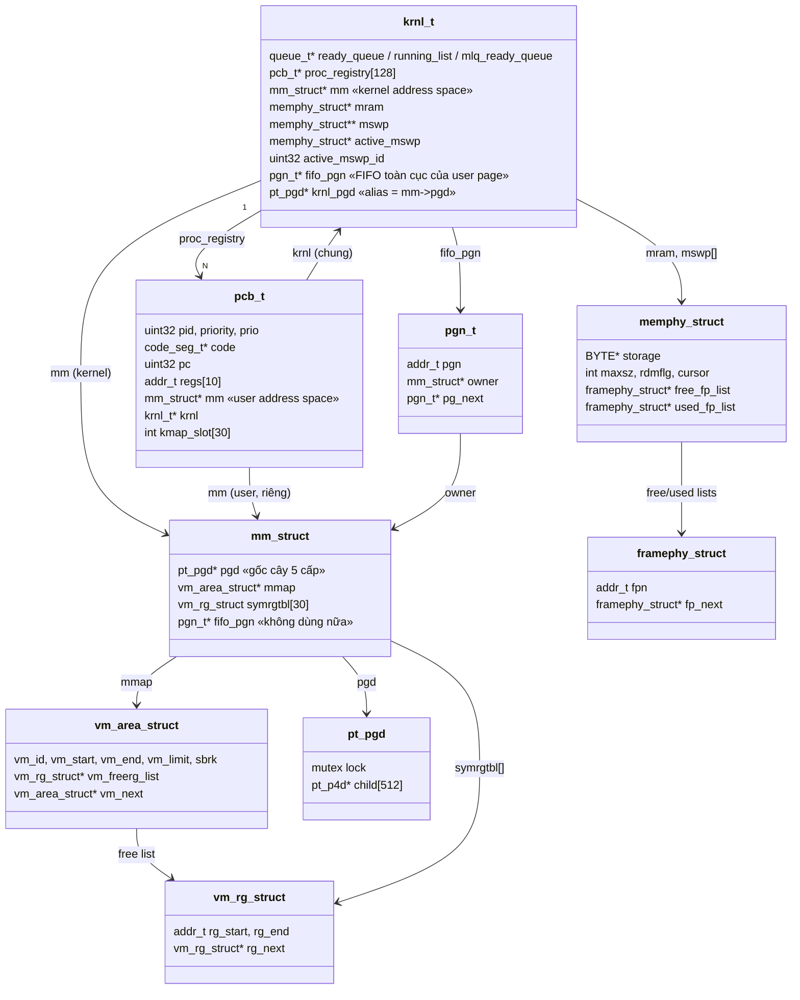
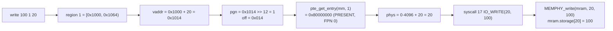
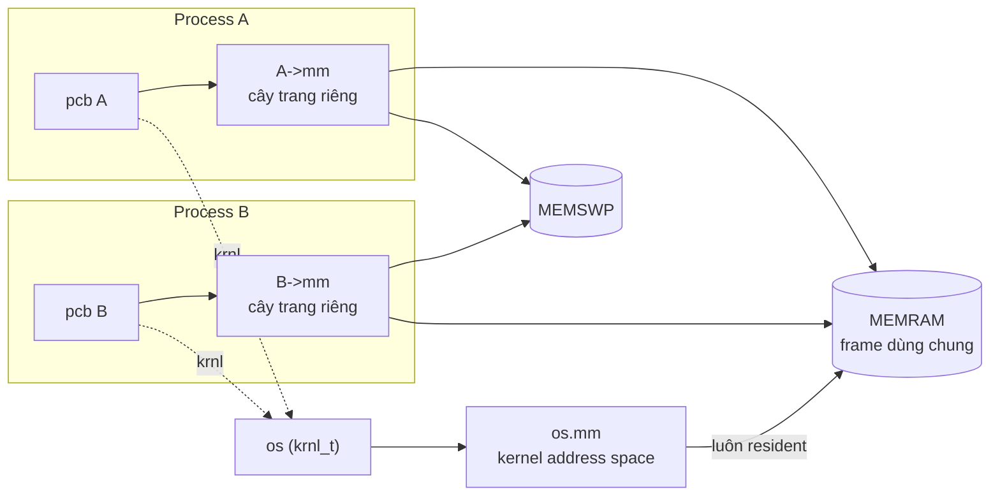

# 01 — Kiến trúc tổng thể của Simple OS Simulator

> Đọc file này **trước khi** mở source code. Mục tiêu: có một "bản đồ" trong đầu để
> mỗi khi đọc một hàm, bạn biết nó nằm ở tầng nào và ai gọi nó.

**Ký hiệu bằng chứng** (dùng trong mọi tài liệu `docs/study/`):

| Ký hiệu | Nghĩa |
|---|---|
| **[V]** Verified | Đã kiểm chứng: đọc code **và** chạy test/simulator (log trong `06-execution-traces.md`). |
| **[C]** Code-read | Đã trace trong code nhưng chưa có lần chạy nào minh họa riêng. |
| **[I]** Inferred | Suy luận từ code/tên/tài liệu nhóm; chưa kiểm chứng trực tiếp. |
| **[U]** Unverified | Chưa kiểm chứng, hoặc không hỗ trợ — đừng khẳng định khi bảo vệ. |

Cấu hình được phân tích: `include/os-cfg.h` với `MLQ_SCHED`, `MM_PAGING`, **`MM64`** bật,
`MM_FIXED_MEMSZ` tắt, build có `-DUSE_DMA` (`Makefile:26`). Nhánh 32-bit (`mm.c`) là
code **deprecated** chỉ in `[ERROR] ... deprecated` — mọi phân tích dưới đây là của
nhánh MM64.

---

## 1. Simulator đang mô phỏng điều gì?

### WHY
Một hệ điều hành thật quá lớn để học. Simulator này giữ lại **3 câu hỏi cốt lõi** của OS:

1. **Ai được chạy trên CPU, khi nào?** → scheduler (MLQ) + timer.
2. **Mỗi process thấy một không gian nhớ riêng như thế nào, trong khi RAM là dùng chung?**
   → virtual memory + paging + swap.
3. **Làm sao chuyển dữ liệu mà CPU không phải tự chép từng byte?** → DMA co-processor.

Và một ràng buộc bảo vệ: **user code không được chạm trực tiếp vào kernel** → system call,
user/kernel address space, `copy_from_user`/`copy_to_user`.

### WHAT — mô phỏng và không mô phỏng

| Thành phần | Được mô phỏng? | Cách mô phỏng thực tế |
|---|---|---|
| CPU | Có (logic) | Mỗi CPU là 1 `pthread` chạy `cpu_routine()` (`src/os.c:322`), mỗi time slot thực thi **1 instruction**. |
| Clock / timer | Có | Thread `timer_routine()` (`src/timer.c:21`) đồng bộ mọi thread theo "time slot" rời rạc. |
| Process | Có | `struct pcb_t` (`include/common.h:135`) + danh sách instruction đọc từ file. |
| Instruction set | Có, rất nhỏ | `calc, alloc, free, read, write, kmalloc, copy_from_user, copy_to_user, dma_memcpy, syscall` (`src/loader.c:44`). Không có jump, không có ALU thật. |
| Register | Một phần | `regs[10]`, nhưng ở chế độ paging gần như **không dùng** (xem §6). |
| Text segment trong RAM | **Không** | Code nằm trong heap của host (`proc->code->text`), spec cũng nói vậy. |
| RAM vật lý | Có | Mảng byte `memphy_struct.storage` (`include/os-mm.h:160`). |
| Swap device | Có (tối đa 4) | Cùng kiểu `memphy_struct`, khác vai trò. |
| Page table | Có, nhưng **trong heap host** | Cây 5 cấp `pt_pgd → … → pt_leaf` cấp bằng `calloc` (`src/mm64.c:75-113`). **Không chiếm frame của RAM mô phỏng.** |
| MMU phần cứng / TLB | **Không** | Dịch địa chỉ là lời gọi hàm phần mềm (`pg_getpage`). Không có TLB dù revision history nhắc tới. |
| Page fault interrupt | **Không** (theo nghĩa trap) | "Page fault" = `pg_getpage` thấy PTE ở trạng thái SWAPPED và tự swap-in đồng bộ. |
| Interrupt / mode bit | **Không** thật | User/kernel chỉ là quy ước gọi hàm + kiểm tra dải địa chỉ. |
| File system, I/O device | **Không** | — |
| DMA co-processor | Có, **RTL thật** | Verilog `dma_top` được Verilator dịch sang C++ (`src/Vdma_top*.cpp`), chạy trên thread worker riêng. |
| GPU | **Không** | Spec để "talent students" tùy chọn. |

---

## 2. Kiến trúc tổng thể

### 2.1 Bản đồ tầng (layer map)

```mermaid
flowchart TB
    subgraph IN["Đầu vào (đĩa)"]
        CFG["input/&lt;config&gt;<br/>time slice, #CPU, #proc, RAM/SWAP sizes"]
        PROG["input/proc/&lt;program&gt;<br/>priority + instructions"]
    end

    subgraph HOST["Thread của host (pthread)"]
        MAIN["main() — os.c:622"]
        LD["ld_routine — loader thread"]
        CPUS["cpu_routine × N — CPU threads"]
        TMR["timer_routine — timer thread"]
        DMAW["dma_worker — DMA thread"]
    end

    subgraph K["Kernel object: static struct krnl_t os (os.c:42)"]
        SCHED["Scheduler MLQ<br/>sched.c / queue.c"]
        REG["proc_registry[128]<br/>(tra PCB theo PID)"]
        SYSC["System call<br/>libstd.c → syscall.c → sys_*.c"]
        KMM["Kernel mm (os.mm)<br/>kmalloc / copy_*"]
        VM["Virtual memory (user)<br/>libmem.c __alloc/__read/..."]
        PG["Paging core<br/>mm64.c + pg_getpage"]
        PHY["MEMPHY<br/>mm-memphy.c"]
    end

    subgraph HW["'Phần cứng' mô phỏng"]
        RAM[("MEMRAM<br/>1 device")]
        SWP[("MEMSWP 0..3")]
        RTL["DMA RTL (Verilator)<br/>dpi_rtl.cpp, sysbus.c"]
    end

    CFG --> MAIN
    PROG --> LD
    MAIN --> LD & CPUS & TMR & DMAW
    LD -->|add_proc| SCHED
    CPUS -->|get_proc / put_proc| SCHED
    CPUS -->|run(proc)| VM & KMM & SYSC
    VM -->|syscall 17| SYSC
    SYSC --> PG & PHY
    VM --> PG
    KMM --> PG & PHY
    PG --> PHY
    PHY --> RAM & SWP
    CPUS -->|dma_memcpy → dma_submit| DMAW
    DMAW --> RTL -->|DPI read/write| RAM
```

**Quy tắc đọc sơ đồ:** mũi tên là "gọi vào". Tầng dưới (PHY, PG) không bao giờ gọi
ngược lên tầng trên — đây là cách chia module của nhóm (`Document/API_CONTRACT.md` §1). **[C]**

### 2.2 Năm loại thread và cách chúng phối hợp

| Thread | Số lượng | Hàm | Việc làm |
|---|---|---|---|
| main | 1 | `main` (`os.c:622`) | Đọc config, tạo RAM/SWAP, khởi động DMA, tạo các thread khác, chờ, dọn dẹp. |
| loader | 1 | `ld_routine` (`os.c:422`) | Tạo kernel mm; tới đúng thời điểm thì `load()` program, tạo `proc->mm`, đăng ký registry, `add_proc`. |
| CPU | N (từ config) | `cpu_routine` (`os.c:322`) | Vòng lặp: lấy process, chạy 1 instruction/slot, hết slice thì trả về queue, hết code thì dọn dẹp process. |
| timer | 1 | `timer_routine` (`timer.c:21`) | Chờ **mọi** thread đã đăng ký báo xong slot hiện tại, rồi tăng `_time` và đánh thức chúng. |
| DMA worker | 1 | `dma_worker` (`os.c:202`) | Lấy yêu cầu từ hàng đợi DMA, chạy RTL (`do_dma`), gọi callback unpin. **Không** gắn với timer. |

Mental model: **timer là "nhạc trưởng" theo nhịp**. Mỗi CPU thread và loader thread
phải gọi `next_slot()` đúng một lần mỗi slot; timer chỉ sang slot mới khi tất cả đã gọi.
Vì vậy dù chạy song song thật trên host, simulator có khái niệm "thời gian" rời rạc. **[V]**

DMA worker thì **không** theo nhịp timer — nó chạy theo tốc độ của RTL. Đây chính là
điểm "bất đồng bộ" (asynchronous) mà spec §2.3.1 yêu cầu. **[C]**

---

## 3. Trách nhiệm từng subsystem

| Subsystem | Câu hỏi nó trả lời | File chính | Hàm quan trọng | Module nhóm |
|---|---|---|---|---|
| Loader | Program trên đĩa → PCB? | `loader.c` | `load` | M4 |
| Scheduler | Process nào chạy tiếp? | `sched.c`, `queue.c` | `get_mlq_proc`, `put_mlq_proc`, `add_mlq_proc` | (chung) |
| CPU | Thực thi 1 instruction thế nào? | `cpu.c` | `run` | M4 |
| Timer | Khi nào sang slot mới? | `timer.c` | `next_slot`, `timer_routine` | M4 |
| User VM API | Biến (region) nằm ở địa chỉ ảo nào? | `libmem.c` (nửa đầu), `mm-vm.c` | `__alloc`, `__free`, `__read`, `__write`, `get_free_vmrg_area` | M2 |
| Paging core | Địa chỉ ảo ↔ frame? Thiếu RAM thì sao? | `mm64.c`, `libmem.c` (`pg_getpage`, `free_pcb_memph`) | `pte_*`, `vm_map_ram`, `alloc_pages_range`, `pg_getpage` | **M1 (bạn)** |
| Physical memory | Frame nào trống? Đọc/ghi byte? | `mm-memphy.c` | `MEMPHY_get_freefp_range`, `MEMPHY_put_freefp`, `MEMPHY_read/write` | **M1 (bạn)** |
| Kernel memory | Cấp bộ nhớ liên tục cho kernel? | `libmem.c` | `__kmalloc`, `__kfree`, `libkmem_copy_*` | M3 |
| System call | User xin kernel làm việc thế nào? | `libstd.c`, `syscall.c`, `sys_mem.c`, `sys_listsyscall.c` | `libsyscall`, `_syscall`, `__sys_memmap`, `get_pcb_by_pid` | M3 |
| DMA | Chép dữ liệu không qua CPU? | `libmem.c` (cuối), `os.c` (đầu), `dma_c_testbench.cpp`, `dpi_rtl.cpp`, `sysbus.c` | `libmem_dma_memcpy`, `dma_submit`, `dma_worker`, `do_dma` | M4 |

---

## 4. Các data structure trung tâm

Hiểu 9 struct dưới đây là hiểu 80% hệ thống.



| Struct | Định nghĩa | Một câu để nhớ |
|---|---|---|
| `krnl_t` | `include/common.h:157` | "Hệ điều hành": một biến duy nhất `static struct krnl_t os` (`os.c:42`), mọi PCB trỏ về nó. |
| `pcb_t` | `include/common.h:135` | Một process: code + pc + `mm` riêng + bảng `kmap_slot` trỏ sang kernel region. |
| `mm_struct` | `include/os-mm.h:121` | Một **address space**: cây page table + danh sách VMA + bảng region (symbol table). |
| `vm_area_struct` | `include/os-mm.h:84` | Một vùng ảo liên tục `[vm_start, vm_end)`, có `sbrk` và giới hạn `vm_limit`. Thực tế chỉ có **vma0**. |
| `vm_rg_struct` | `include/os-mm.h:72` | Một "biến" (region) `[rg_start, rg_end)`, hoặc một khoảng trống trong free list. |
| `memphy_struct` | `include/os-mm.h:160` | Một thiết bị nhớ vật lý (RAM hoặc SWAP): mảng byte + danh sách frame trống/đang dùng. |
| `framephy_struct` | `include/os-mm.h:152` | Một node "frame số `fpn`" trong free/used list. |
| `pgn_t` | `include/os-mm.h:61` | Một node FIFO: "page `pgn` của address space `owner`". |
| `pt_pgd … pt_leaf` | `src/mm64-internal.h:9-30` | 5 tầng của cây page table; chỉ `mm64.c` biết bên trong (opaque). |

---

## 5. Luồng khởi động và kết thúc

### 5.1 Startup **[V]**

```mermaid
sequenceDiagram
    autonumber
    participant M as main (os.c)
    participant T as timer
    participant P as MEMPHY
    participant D as DMA service
    participant L as loader thread
    participant C as CPU threads

    M->>M: read_config("input/<cfg>") — dòng 1, dòng RAM/SWAP (tùy chọn), các dòng process
    M->>T: attach_event() × (N CPU + 1 loader), start_timer()
    M->>M: clamp RAM ≤ 256 MiB, SWAP ≤ 8 GiB (os.c:660-673)
    M->>P: init_memphy(mram), init_memphy(mswp[0..3])
    M->>D: memory_bank_attach(mram.storage) + dma_service_start()
    M->>M: tạo registry_lock, init_scheduler()
    M->>L: pthread_create(ld_routine)
    M->>C: pthread_create(cpu_routine) × N
    L->>L: os.mm = calloc; init_mm(os.mm, NULL) → kernel vma0 tại 0xFF00…00
    L->>L: os.krnl_pgd = os.mm->pgd (alias)
    loop mỗi process i
        L->>L: load(path) → PCB; kmap_slot[] = -1; prio = prio từ config
        L->>T: next_slot() cho tới start_time[i]
        L->>L: proc->mm = calloc; init_mm(proc->mm, proc) → user vma0 tại 0x1000
        L->>L: đăng ký proc_registry
        L->>C: add_proc(proc) (vào mlq_ready_queue[prio])
    end
    L->>L: done = 1; detach_event
```

Hai chi tiết đáng nhớ:
- **RAM/SWAP được tạo trong stack của `main`** (`os.c:653-654`) — sống tới khi `main` kết thúc,
  nên mọi thread dùng được. **[C]**
- Kernel address space (`os.mm`) được tạo **trong loader thread**, không phải trong `main`. **[C]**

### 5.2 Shutdown **[V]**
1. CPU thread nào thấy `get_proc() == NULL` **và** `done == 1` thì in `CPU x stopped` và thoát
   (`os.c:393-400`). Thứ tự "đọc `done` trước rồi mới `get_proc`" tránh race với loader.
2. `main` join mọi CPU + loader → `dma_service_stop()` (worker làm nốt hàng đợi rồi thoát)
   → `memory_bank_cleanup()` → `stop_timer()` → `free(mram.storage)`, `free(mswp[i].storage)`.
3. **Không** giải phóng `os.mm` (kernel address space sống tới cuối, rồi process thoát). **[C]**

### 5.3 Khi một process kết thúc (`os.c:332-378`) **[V]**
Thứ tự có chủ đích (mỗi bước bảo vệ bước sau):

1. `dma_process_exit(pid)` — **chờ** DMA của process xong (tránh RTL ghi vào frame đã trả).
2. Gỡ khỏi `proc_registry` — từ giờ syscall với PID này bị từ chối.
3. `__kfree` mọi kernel region còn giữ (`kmap_slot[k] != -1`).
4. `free_pcb_memph(proc)` — trả frame RAM, slot SWAP, cây page table, FIFO node, VMA.
5. `free(proc->mm)`, `finish_proc` (gỡ khỏi `running_list`), free code + PCB.

---

## 6. Luồng điều khiển và luồng dữ liệu

### 6.1 Một instruction đi xuống các tầng như thế nào
`run()` (`src/cpu.c:76`) là **bộ giải mã** duy nhất. Nó chỉ chuyển instruction thành lời gọi thư viện:

| Instruction | Hàm thư viện | Tầng chạm tới |
|---|---|---|
| `calc` | `calc` | không gì cả |
| `alloc size r` | `liballoc` → `__alloc` | VM → syscall INC (no-op) → `vm_map_ram` → MEMPHY |
| `free r` | `libfree` → `__free` | chỉ VM (free list) |
| `read r off dst` | `libread` → `__read` → `pg_getval` | VM → `pg_getpage` (có thể swap) → syscall `IO_READ` → MEMPHY |
| `write v r off` | `libwrite` → `__write` → `pg_setval` | như trên, `IO_WRITE` |
| `kmalloc size r` | `libkmem_malloc` → `__kmalloc` | kernel mm → MEMPHY (frame liên tục) |
| `copy_from_user u k off sz` | `libkmem_copy_from_user` | `__read_user_mem` + `__write_kernel_mem` từng byte |
| `copy_to_user k u off sz` | `libkmem_copy_to_user` | `__read_kernel_mem` + `__write_user_mem` từng byte |
| `dma_memcpy s d off sz` | `libmem_dma_memcpy` | dịch VA→PA, ghim frame, `dma_submit` → DMA worker |
| `syscall nr a1 a2 a3` | `libsyscall` → `_syscall` | dispatch theo `syscalltbl.lst` |

### 6.2 Điểm "ngạc nhiên" #1 — toán hạng "register" thực ra là **region ID** **[V]**

Spec mô tả `alloc 124 7` = "ghi địa chỉ vào **register** 7". Trong code paging, số `7`
được dùng làm **chỉ số vào `mm->symrgtbl[7]`** (symbol table), **không** ghi vào `regs[7]`:

- `liballoc(proc, size, reg_index)` → `__alloc(proc, 0, reg_index, …)` ghi
  `symrgtbl[rgid]` (`libmem.c:87-88, 164-165`), không đụng `proc->regs`.
- `read 1 20 2` = "đọc byte ở offset 20 của **region 1**", rồi ghi vào `regs[2]`
  (`cpu.c:120-134`). Đây là instruction duy nhất ghi `regs[]`.
- Loader cố ý **bỏ kiểm tra** chỉ số register khi `MM_PAGING` (`loader.c:172-177`) vì
  program mẫu dùng `read 1 20 20`.

Hệ quả khi bảo vệ: hãy nói "register index được hiểu như variable/region ID trong symbol
table, đúng với ý spec §1.3 *Annotation of Memory region*", và thừa nhận `regs[]` không giữ địa chỉ.

### 6.3 Điểm "ngạc nhiên" #2 — offset của read/write là **thập phân** **[C]**
Spec ví dụ "20 là 14 hệ hex". Loader parse **thập phân**, chỉ nhận hex khi có tiền tố `0x`
(`loader.c:129-133`). Log xác nhận: `write 100 1 20` ghi vào phys `addr=20`. **[V]**

### 6.4 Luồng dữ liệu của một byte được ghi

(Số liệu lấy từ lần chạy `os_0_mlq_paging`, xem `06` §4.)

---

## 7. Process, CPU, scheduler, memory và kernel liên hệ thế nào?

Một câu tổng kết: **PCB là "điểm nối"**.

- Scheduler chỉ biết **con trỏ PCB** trong các queue (không biết gì về bộ nhớ).
- CPU lấy PCB từ scheduler, đọc `code->text[pc]`, gọi thư viện với PCB đó.
- Thư viện user (VM) dùng `pcb->mm` (address space riêng) để dịch địa chỉ.
- Thư viện kernel dùng `pcb->krnl->mm` (address space **chung**) và `pcb->kmap_slot[]`
  để biết region kernel nào thuộc process này.
- Khi vào "kernel" qua syscall, chỉ **PID** được truyền (`_syscall(krnl, pid, nr, regs)`),
  kernel tự tra PCB qua `get_pcb_by_pid` (`sys_mem.c:24`). Đây là yêu cầu của spec §3.3
  ("PID passing, not direct PCB passing"). **[V]**
- Physical memory (`krnl->mram`, `krnl->mswp`) là **singleton dùng chung**; mọi address space
  (user lẫn kernel) đều lấy frame từ cùng một RAM.



---

## 8. Những điểm cần nhớ trước khi đọc code

1. **Page size MM64 = 4096 B** (`mm64.h:10`). Config có RAM 2048 B (`os_syscall`, `os_sc`,
   `os_syscall_list`, `os_1_mlq_paging_small_1K`) → RAM có **0 frame** → mọi `alloc` user thất bại. **[V]**
2. Page table nằm trong **heap host**, không tốn frame RAM mô phỏng. `print_pgtbl` in địa chỉ host. **[V]**
3. `inc_vma_limit` (handler của `SYSMEM_INC_OP`) là **stub trả 0** (`mm-vm.c:136-152`). Việc
   mở rộng vùng nhớ thật sự nằm trong `__alloc` (`libmem.c:123-161`). **[V]**
4. FIFO page replacement là **toàn cục** (`krnl->fifo_pgn`): process B có thể đẩy page của A ra swap. **[V]**
5. Kernel page **không bao giờ** bị swap, không nằm trong FIFO. **[C]**
6. `free` **không trả frame**; frame chỉ được trả khi process kết thúc. **[C]**

Chi tiết từng điểm nằm trong `03` (paging), `04` (VM), `05` (kernel/syscall/DMA).

---

## Active recall

1. Kể tên 5 loại thread trong simulator và thread nào **không** đồng bộ theo timer. Tại sao như vậy là hợp lý?
2. `struct krnl_t os` được khai báo ở đâu, và mỗi PCB truy cập nó qua field nào?
3. Vì sao nói "PCB là điểm nối"? Scheduler biết gì và không biết gì về PCB?
4. Trong chế độ paging, `alloc 300 4` ghi kết quả vào đâu? `regs[4]` có thay đổi không?
5. Spec nói có TLB và page fault interrupt — simulator có mô phỏng không? Thay thế bằng gì?
6. Liệt kê 5 bước dọn dẹp khi process kết thúc và giải thích vì sao bước "chờ DMA" phải đứng đầu.
7. Tại sao config `os_syscall` (RAM 2048 B) làm `alloc 100 1` thất bại?
8. Page table chiếm bộ nhớ ở đâu? Điều đó ảnh hưởng gì tới việc thống kê "storage of multilevel paging"?

## Bài tập nhỏ

1. Mở `src/os.c` và đánh dấu 3 chỗ gọi `next_slot()`. Giải thích vì sao CPU thread gọi nó cả khi không có process.
2. Vẽ lại sơ đồ §2.1 trên giấy **không nhìn**, rồi so sánh.
3. Với config `input/os_0_mlq_paging`, viết ra: time slice, số CPU, số process, kích thước RAM, số frame RAM (= RAM/4096).
