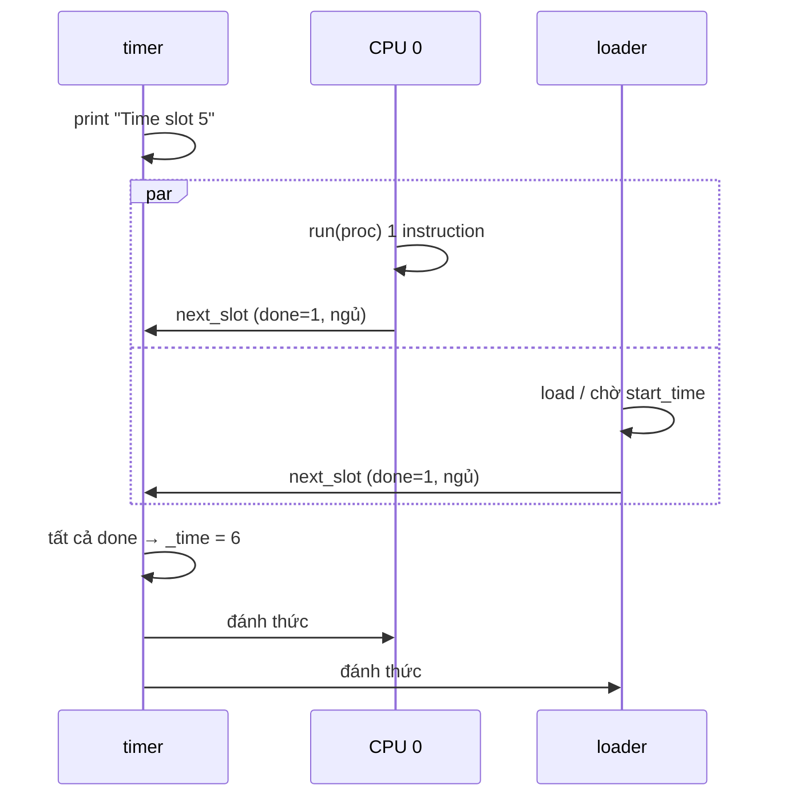
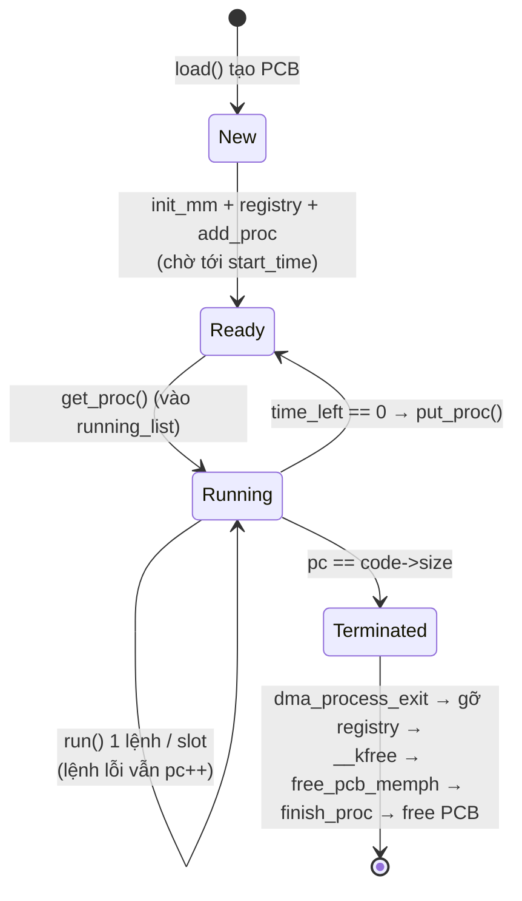
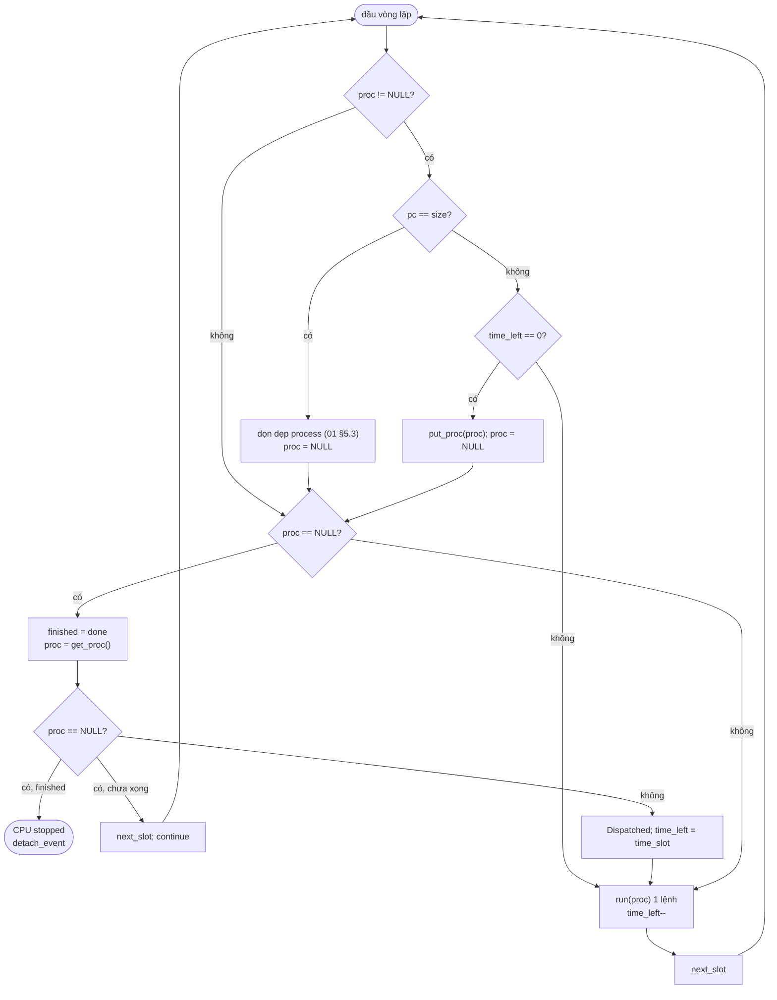

# 02 — Process, CPU và Scheduler

> Tiên quyết: `01-system-architecture.md` §2, §4. Ký hiệu [V]/[C]/[I]/[U] như trong `01`.

Tài liệu này trả lời: *một file program trên đĩa trở thành process chạy trên CPU như thế
nào, ai quyết định process nào chạy, và một instruction bộ nhớ được "kích hoạt" ra sao.*

---

## 1. Process representation — PCB

### WHY
CPU chỉ biết "chạy instruction tiếp theo". Để nhiều chương trình chia sẻ CPU, OS phải
lưu **trạng thái** của mỗi chương trình khi nó bị tạm dừng: đang ở instruction nào, đang
dùng bộ nhớ nào, độ ưu tiên bao nhiêu. Đó là PCB.

### WHAT — các field thực sự được dùng (`include/common.h:135-154`)

| Field | Ai ghi | Ai đọc | Ý nghĩa thực tế |
|---|---|---|---|
| `pid` | `load()` (`loader.c:229`, tăng dần từ 1) | mọi nơi, syscall | Định danh; kernel tra PCB qua PID. |
| `priority` | `load()` từ dòng đầu program | (không dùng khi MLQ) | "Default priority" của program. |
| `prio` | `ld_routine` (`os.c:472`) từ config | `add/put_mlq_proc` | **Live priority** — ghi đè `priority`. Chọn queue. |
| `code` | `load()` | `run()` | Mảng `inst_t` trong heap host. |
| `pc` | `run()` (`pc++`) | `run()`, `cpu_routine` | Chỉ số instruction kế tiếp. `pc == code->size` ⇒ xong. |
| `regs[10]` | `run()` case READ | — | Chỉ READ ghi vào (xem `01` §6.2). |
| `mm` | `ld_routine` (`init_mm`) | toàn bộ VM/paging | **User address space riêng**. |
| `krnl` | `ld_routine` (`proc->krnl = &os`) | mọi lib | Con trỏ về kernel duy nhất. |
| `kmap_slot[30]` | `ld_routine` (= -1), `__kmalloc`, `__kfree` | kernel mem, cleanup | Ánh xạ "region ID kernel của process" → slot trong `os.mm->symrgtbl`. |
| `page_table`, `bp` | `load()` | không ai | Legacy, spec nói *obsolete*. |

---

## 2. Process loading

### 2.1 Định dạng program (`input/proc/*`)
```
[priority] [N]
instruction 0
...
instruction N-1
```
Ví dụ `input/proc/m0s`:
```
1 6
alloc 300 0
alloc 100 1
free 0
alloc 100 2
write 102 1 20
write 1 2 1000
```

### 2.2 `load(path)` (`src/loader.c:202-301`) **[C]**
1. Đọc header bằng `next_line` (bỏ dòng trống, `#` là comment) + `parse_args`.
2. `calloc` PCB, gán `pid = avail_pid++`, `priority`, `prio = priority` (tạm), `pc = 0`.
3. Mỗi dòng: tách opcode (không phân biệt hoa thường), tra `op_table` (`loader.c:44-57`)
   để biết số tham số tối thiểu/tối đa và tham số nào được âm (chỉ `write` arg 0:
   `write -1 1 2` ghi byte `0xFF`).
4. Lỗi cú pháp ⇒ in `Loader error: …` và **`exit(1)` cả simulator** (`die`, `loader.c:63`).

`avail_pid` là `static` không khóa — chỉ an toàn vì **chỉ loader thread** gọi `load()`. **[I]**

### 2.3 Định dạng config (`input/<name>`) — spec vs code

| Dòng | Spec §2.2.5 | Code (`read_config`, `os.c:563`) |
|---|---|---|
| 1 | `time_slice N_CPU M_proc` | Giống. |
| 2 | `KERNEL_BASE_ADDR` | **Không hỗ trợ.** Kernel base cố định `0xFF00…00` (`mm64.h:14`). **[C]** |
| 3 | `RAM SWP0 SWP1 SWP2 SWP3` | Dòng **tùy chọn**: nhận ra nếu đúng 5 số (`read_memsz_line`, `os.c:534`). Không có ⇒ RAM 1 MiB, SWP0 16 MiB. |
| tiếp | `time path prio` | Giống; path được nối thành `input/proc/<path>`. Prio ≥ 140 bị kẹp về 139. |

---

## 3. Instruction representation và CPU execution

### 3.1 `struct inst_t` (`common.h:96`)
`opcode` + 4 đối số `arg_0..arg_3` kiểu `arg_t` (= `uint64_t` khi MM64).

### 3.2 `run(proc)` (`src/cpu.c:76-153`) **[C]**
```
nếu pc >= code->size: return 1
ins = code->text[pc]; pc++          ← pc tăng TRƯỚC khi thực thi
switch opcode → gọi lib tương ứng (bảng ở 01 §6.1)
return stat (0 = thành công)
```
Hệ quả: một instruction **thất bại vẫn tiêu tốn pc** — process không "kẹt" ở đó mà chạy
tiếp instruction sau. `cpu_routine` chỉ in `instruction at pc=X failed` (`os.c:412-414`). **[V]**

Bảng ngữ nghĩa instruction (paging mode):

| Instruction | arg_0 | arg_1 | arg_2 | arg_3 | Ghi chú thực tế |
|---|---|---|---|---|---|
| `alloc` | size (byte) | region ID | — | — | region ở user `symrgtbl` |
| `free` | region ID | — | — | — | |
| `read` | region ID nguồn | offset | register đích | — | ghi `regs[arg_2]` nếu `< 10` |
| `write` | giá trị (byte) | region ID | offset | — | |
| `kmalloc` | size | **kernel** region ID | — | — | không gian ID riêng (`kmap_slot`) |
| `copy_from_user` | user region | kernel region | offset | size | |
| `copy_to_user` | kernel region | user region | offset | size | thứ tự: nguồn rồi đích |
| `dma_memcpy` | user region | user region | offset | size | **chỉ user region** |
| `syscall` | số syscall | a1 | a2 | a3 | |

---

## 4. Timer và mô hình time slot

### WHY
Thread của host chạy tự do. Để kết quả có "thời gian" so sánh được (Gantt chart), mọi
thread phải bước theo nhịp chung.

### HOW (`src/timer.c`) **[V]**
- Mỗi thread "thiết bị" (N CPU + 1 loader) có một `timer_id_t` (`attach_event`, phải gọi
  **trước** `start_timer`).
- `next_slot(id)`: báo `done = 1`, rồi ngủ cho tới khi timer xóa `done`.
- `timer_routine`: in `Time slot N`, chờ **tất cả** thiết bị `done` (hoặc `fsh` = đã thoát),
  rồi `_time++` và đánh thức tất cả. Khi mọi thiết bị đã `detach_event` thì dừng.



**Hệ quả quan trọng:** trong **một slot**, các thread chạy *song song thật* — log của
CPU 0 và CPU 1 trong cùng slot có thể xen kẽ ngẫu nhiên. Đây là lý do spec nói "có thể có
nhiều output đúng" và lý do phải có lock cho bộ nhớ dùng chung. **[V]**

---

## 5. Scheduling algorithm — Multi-Level Queue (MLQ)

### 5.1 Spec yêu cầu gì (§2.1)
- `MAX_PRIO = 140` queue, mỗi queue một priority (0 = cao nhất).
- Queue `prio` có **slot = MAX_PRIO − prio** lượt dùng CPU; dùng hết thì nhường queue sau,
  phần còn lại để dành cho vòng sau.
- Trong một queue: round-robin.
- **Không** có feedback (không chuyển process giữa các queue).

### 5.2 Code thực tế (`src/sched.c`) **[C]**
Trạng thái: `mlq_ready_queue[140]`, `slot[140]` (khởi tạo `slot[i] = 140 − i`, `sched.c:50`),
một `queue_lock`, và `running_list`.

```
get_mlq_proc():                                   # sched.c:70
  lock
  first_nonempty = NONE
  for prio = 0..139:
      if queue[prio] rỗng: continue
      if slot[prio] > 0: chọn prio; break
      if first_nonempty == NONE: first_nonempty = prio
  if không chọn được nhưng first_nonempty tồn tại:     # mọi queue không rỗng đều hết slot
      reset slot[i] = 140 - i cho mọi i
      chọn first_nonempty
  if đã chọn:
      proc = dequeue(queue[prio])    # FIFO: lấy phần tử đầu (queue.c:32-34)
      slot[prio]--                    # MỘT slot = MỘT lần dispatch (một time slice)
      enqueue(running_list, proc)
  unlock; return proc

put_mlq_proc(proc):  lock; purge khỏi running_list; enqueue(queue[proc->prio]); unlock
add_mlq_proc(proc):  lock; enqueue(queue[proc->prio]); unlock
```

### 5.3 Diễn giải đúng
- "Slot" ở đây được đếm theo **số lần dispatch**, không phải số instruction. **[C]**
- Với các test mẫu (≤ 8 process, mỗi process vài chục instruction), queue priority cao
  **không bao giờ** dùng hết 140−prio lượt ⇒ hành vi quan sát được ≈ **strict priority +
  round-robin trong cùng priority**. Cơ chế "nhường lượt" chỉ lộ ra khi một queue cao
  được dispatch hơn `140−prio` lần trong một vòng. **[I]** (suy ra từ code + log `sched_0`).
- `enqueue` **lặng lẽ bỏ** process nếu queue đầy (`MAX_QUEUE_SIZE = 50`, `queue.c:16`) ⇒
  process biến mất khỏi hệ thống. Không xảy ra với input mẫu. **[C]**

### 5.4 Ví dụ có số liệu — `input/sched_0` **[V]**
Config: time slice 2, 1 CPU. P1 = s0 (prio 4, t=0), P2 = s0 (prio 4, t=1), P3 = s1
(prio 0, t=4, 7 lệnh), P4 = s0 (prio 0, t=5, 15 lệnh).

| Slot | 0–1 | 2–3 | 4–5 | 6–7 | 8–9 | 10–11 | 12–13 | 14–15 | 16–17 | 18 | 19–… |
|---|---|---|---|---|---|---|---|---|---|---|---|
| CPU 0 | P1 | P2 | P1 | **P3** | **P4** | P3 | P4 | P3 | P4 | P3 (xong) | P4 … |

Đọc bảng:
- Slot 4: P3 vừa được load **cùng slot** với lần dispatch, nhưng dispatch xảy ra trước
  (race giữa loader và CPU trong một slot) ⇒ P1 được chọn.
- Từ slot 6, queue prio 0 không rỗng ⇒ P3/P4 luân phiên; P1, P2 (prio 4) phải chờ tới khi
  P3, P4 xong. Đây là strict priority.
- P3 có 7 lệnh: 2+2+2+1 ⇒ xong ở slot 18, slot 19 in `Processed 3 has finished`.

Đây chính là dữ liệu để vẽ **Gantt chart** mà spec §3.3 yêu cầu.

---

## 6. Process lifecycle



**Không có** trạng thái Waiting/Blocked: không lệnh nào khiến process ngủ chờ I/O.
`dma_memcpy` trả về ngay, process vẫn Running. **[C]**

---

## 7. CPU, scheduler, process tương tác — `cpu_routine` (`os.c:322-420`) **[V]**



Lưu ý: kiểm tra `pc == size` và `time_left == 0` xảy ra **đầu** vòng lặp kế tiếp, tức
ở slot sau. Vì vậy log `Processed X has finished` xuất hiện ở slot ngay sau lệnh cuối.

---

## 8. Memory instruction và system call được kích hoạt thế nào

Trace `write 100 1 20` của process PID 1 (chi tiết bộ nhớ ở `03`, `04`):

```mermaid
sequenceDiagram
    participant CPU as cpu_routine
    participant RUN as run (cpu.c)
    participant LIB as libwrite/__write (libmem.c)
    participant PG as pg_setval/pg_getpage
    participant SC as _syscall → __sys_memmap
    participant PHY as MEMPHY_write
    CPU->>RUN: run(proc)
    RUN->>LIB: libwrite(proc, 100, 1, 20)
    LIB->>LIB: lock mmvm_lock; kiểm tra region 1, offset, user space
    LIB->>PG: pg_setval(mm, 0x1014, 100)
    PG->>PG: pg_getpage(pgn=1) → fpn 0
    PG->>SC: _syscall(krnl, pid=1, 17, {IO_WRITE, 20, 100})
    SC->>SC: get_pcb_by_pid(1)
    SC->>PHY: MEMPHY_write(mram, 20, 100)
    LIB->>LIB: unlock; print_pgtbl
```

Syscall do **user program** gọi trực tiếp (`syscall nr …`) đi đường ngắn hơn:
`run` → `libsyscall` (`libstd.c:14`) → `_syscall` → handler. Xem `05`.

---

## 9. Trace một process từ load đến kết thúc — `p0s` trong `os_0_mlq_paging` **[V]**

| Giai đoạn | Sự kiện (log thật) | Hàm |
|---|---|---|
| t=0 | `Loaded a process at input/proc/p0s, PID: 1 PRIO: 0` | `ld_routine` → `load`, `init_mm`, `add_proc` |
| t=0 | `CPU 0: Dispatched process 1` | `get_proc` |
| pc 0 | `calc` | `calc` |
| pc 1 | `[SYSCALL] … INC pid=1 a2=0 a3=300` + dòng `PDG=…` | `__alloc` → map page 1 |
| pc 2–4 | `alloc 300 4` (tái dùng free list), `free 0`, `alloc 100 1` | `__alloc`, `__free` |
| pc 5 | `IO_WRITE pid=1 addr=20 value=100` | `pg_setval` |
| … | `Put process 1 to run queue` / `Dispatched process 1` | hết time slice 6 |
| pc 6 | `IO_READ pid=1 addr=20 value=100` | `pg_getval` |
| pc 7–10 | `[User Write]/[User Read] … (rgid=2/3) không hợp lệ` | region 2, 3 chưa từng alloc ⇒ lỗi **có chủ đích** của program mẫu |
| pc 12 | `free 4` | |
| cuối | `CPU 0: Processed 1 has finished` | dọn dẹp |

---

## Active recall

1. `prio` và `priority` khác nhau thế nào? Field nào quyết định queue?
2. Trong `get_mlq_proc`, `slot[prio]` giảm khi nào: mỗi instruction hay mỗi lần dispatch?
3. Khi nào toàn bộ `slot[]` được reset? Viết điều kiện chính xác.
4. Vì sao với input mẫu, MLQ trông giống strict priority?
5. Một instruction lỗi có làm process dừng không? Dòng code nào quyết định?
6. Tại sao `Processed X has finished` xuất hiện ở slot **sau** lệnh cuối cùng?
7. Process có trạng thái Blocked không? `dma_memcpy` có làm process chờ không?
8. Điều gì xảy ra nếu 51 process cùng ở một queue?

## Bài tập nhỏ

1. Từ log `sched_0` (chạy theo `06` §0), vẽ Gantt chart đầy đủ tới khi CPU dừng.
2. Tính: nếu một process prio 139 và một process prio 138 cùng chờ mãi, mỗi vòng mỗi process được dispatch bao nhiêu lần trước khi slot bị reset?
3. Sửa (trong bản copy ở `/tmp`, **không** sửa repo) `input/sched_0` thành 2 CPU, chạy lại và giải thích vì sao thứ tự log khác.
