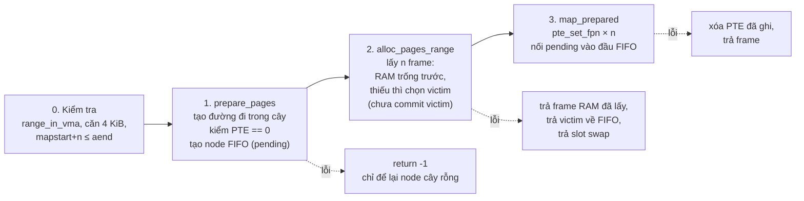
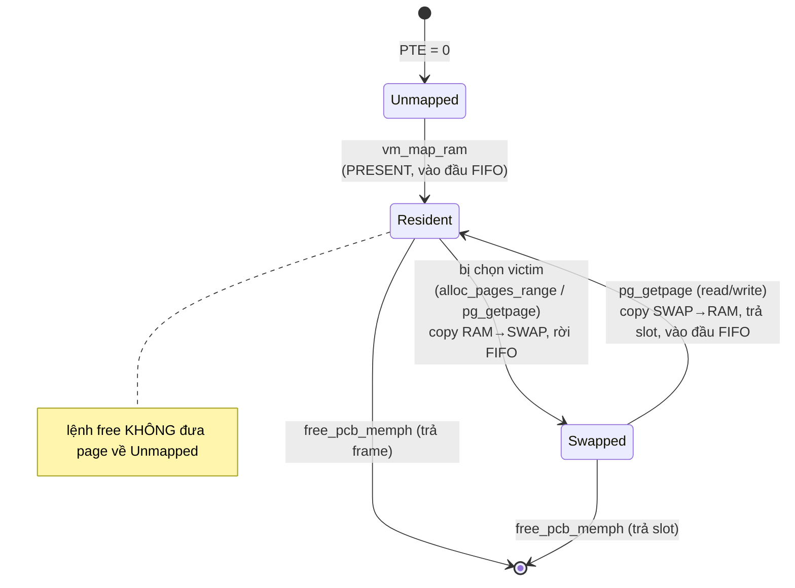

# 03 — Physical Memory và Paging (Module 1 — phần bạn phụ trách)

> Tiên quyết: `01` (toàn bộ), `02` §3. Ký hiệu [V]/[C]/[I]/[U] như trong `01`.
> Mọi ví dụ số trong file này đều lấy từ lần chạy thật hoặc tính tay đã kiểm tra lại
> bằng Python; log đầy đủ ở `06-execution-traces.md`.

## 0. Bản đồ module

| Lớp | File | Hàm public | Ai gọi |
|---|---|---|---|
| Thiết bị vật lý | `src/mm-memphy.c` | `init_memphy`, `MEMPHY_format`, `MEMPHY_get_freefp(_range)`, `MEMPHY_put_freefp`, `MEMPHY_read/write`, `MEMPHY_dump` | `os.c`, `mm64.c`, `libmem.c`, `sys_mem.c` |
| Cây page table + PTE | `src/mm64.c` (nửa đầu), `src/mm64-internal.h` | `mm64_pgd_create/destroy`, `mm64_pt_foreach`, `init_pte`, `get_pd_from_address/pagenum`, `pte_get/set/clear_entry`, `pte_set_fpn`, `pte_set_swap(_mm)` | `mm64.c`, `libmem.c` |
| Mapping + replacement | `src/mm64.c` (nửa sau) | `vm_map_ram`, `alloc_pages_range`, `vmap_page_range`, `vmap_pgd_memset`, `mm64_fifo_victim`, `mm64_fifo_drop`, `__swap_cp_page`, `init_mm`, `print_pgtbl` | `libmem.c`, `sys_mem.c`, `os.c` |
| Translation + swap-in + teardown | `src/libmem.c` | `pg_getpage` (`:284`), `find_victim_page` (`:1674`), `free_pcb_memph` (`:1596`) | `pg_getval/setval`, `os.c` |
| Hằng số | `include/mm.h`, `include/mm64.h` | macro PTE, layout 57-bit | mọi nơi |

Đọc theo đúng thứ tự các mục dưới đây: **dưới lên** (byte → frame → PTE → cây → mapping →
replacement), sau đó **trên xuống** bằng worked example §10.

---

## 1. WHY — vì sao cần physical memory manager và paging?

**Vấn đề:** N process mỗi process muốn một không gian nhớ "riêng, liên tục, bắt đầu từ
địa chỉ đẹp", nhưng chỉ có **một** RAM nhỏ, bị chia vụn khi các process tới/đi.

**Giải pháp paging:**
1. Chia RAM thành các ô cố định gọi là **frame** (ở đây 4096 B).
2. Chia không gian ảo của mỗi process thành **page** cùng kích thước.
3. Mỗi process có một **page table**: "page số `pgn` đang nằm ở frame số `fpn`".
4. Vì frame nào cũng như nhau, không có external fragmentation; page liên tục về mặt ảo
   có thể nằm ở các frame rời rạc.
5. RAM không đủ ⇒ đẩy bớt page ra **swap** (thiết bị lớn, chậm), đánh dấu trong PTE, khi cần
   thì nạp lại (swap-in).

Module 1 hiện thực **4 trách nhiệm**: quản lý frame (ai trống/ai dùng), lưu ánh xạ
page→frame (page table), dịch địa chỉ, và thay trang khi RAM đầy.

---

## 2. Physical memory representation — `struct memphy_struct`

### 2.1 WHAT (`include/os-mm.h:152-174`)

```c
struct framephy_struct { addr_t fpn; struct framephy_struct *fp_next; struct mm_struct *owner; };
struct memphy_struct {
   BYTE *storage;  int maxsz;        // mảng byte và kích thước
   int rdmflg;     int cursor;       // random/sequential access
   struct framephy_struct *free_fp_list;   // frame trống, SẮP XẾP TĂNG theo fpn
   struct framephy_struct *used_fp_list;   // frame đã cấp ("checked out")
};
```

Mental model: **một cái tủ có `maxsz/4096` ngăn**. `storage` là bản thân cái tủ; hai
danh sách là **sổ sách**: mỗi ngăn có đúng một thẻ, thẻ nằm ở sổ "trống" hoặc sổ "đang dùng".

### 2.2 Invariants của MEMPHY **[V]** (kiểm bởi `tests/test_memphy.c`, `test_model_cycles`)
1. Mỗi frame `0 … maxsz/4096 − 1` xuất hiện **đúng một lần** trong đúng một danh sách.
2. `free_fp_list` **luôn tăng dần** theo `fpn` (nhờ vậy tìm được dãy frame liên tiếp).
3. Byte thừa `maxsz % 4096` không thuộc frame nào (không bao giờ được cấp).
4. Chỉ đổi danh sách qua API có khóa `memphy_lock`; module khác **không** sửa danh sách trực tiếp.
5. `owner` là field dự phòng, luôn `NULL`.

### 2.3 HOW — khởi tạo
- `init_memphy(mp, max_size, rdm)` (`mm-memphy.c:74`): reset struct, từ chối `max_size > INT_MAX`
  (vì `maxsz` là `int`), `size == 0` ⇒ thiết bị rỗng hợp lệ (0 frame), ngược lại `malloc` +
  `memset 0` + `MEMPHY_format`.
- `format_locked` (`:40`): xây danh sách `0,1,…,count−1` **trước**, rồi mới thay danh sách cũ
  ("build first, then publish") ⇒ thất bại giữa chừng không làm hỏng thiết bị. Cấm format khi
  còn frame đang dùng.

Ví dụ: RAM 8192 B ⇒ 2 frame ⇒ `free = [0, 1]`, `used = []`. RAM 2048 B ⇒ **0 frame**. **[V]**

### 2.4 HOW — cấp phát: `MEMPHY_get_freefp_range(mp, count, &fpn)` (`:105-141`)
Một thuật toán duy nhất phục vụ cả cấp 1 frame (user page) và cấp `n` frame **liên tiếp**
(kernel `kmalloc`).

```
lock
for mỗi vị trí link trong free list:
    first = *link; last = first; len = 1
    while len < count và last->next liên tiếp (fpn+1): last = last->next; len++
    if len == count:
        gỡ [first..last] khỏi free list (một phép nối con trỏ)
        đẩy cả đoạn lên ĐẦU used list
        *fpn = first->fpn; unlock; return 0
    link = &last->next        # bỏ qua cả đoạn ngắn: không dãy nào bắt đầu bên trong nó đủ dài
unlock; return -1            # không đổi gì
```

**Ví dụ trước/sau** (`count = 3`):

| | free_fp_list | used_fp_list | kết quả |
|---|---|---|---|
| Trước | `1 → 2 → 5 → 6 → 7` | `0 → 3 → 4` | |
| Quét | `[1,2]` dài 2 < 3 ⇒ nhảy tới sau `2`; `[5,6,7]` dài 3 ✔ | | |
| Sau | `1 → 2` | `5 → 6 → 7 → 0 → 3 → 4` | `fpn = 5` |

Thiết kế: **không `malloc` khi cấp/trả** (node di chuyển giữa hai danh sách) ⇒ cấp phát
không thể thất bại vì thiếu heap host. Độ phức tạp O(số frame trống).

### 2.5 HOW — trả frame: `MEMPHY_put_freefp(mp, fpn)` (`:148-179`)
1. Tìm node `fpn` trong **used** list — không có ⇒ `-1` (bắt lỗi trả 2 lần, trả frame chưa cấp).
2. Gỡ khỏi used, chèn vào free **đúng vị trí tăng dần**. O(n).

### 2.6 Đọc/ghi byte
`MEMPHY_read/write(mp, addr, …)` (`:232`, `:248`): kiểm `addr < maxsz`, đọc/ghi `storage[addr]`
dưới `memphy_lock`. Bản `seq_*` chỉ cho phép thiết bị sequential. Cả RAM lẫn SWAP được tạo với
`rdmflg = 1` (`os.c:651`) nên phần "sequential/cursor" của spec có nhưng **không được dùng**. **[C]**

### 2.7 Khóa
`memphy_lock` là **một mutex static cho mọi thiết bị** (`:27`), là **khóa lá**: đang giữ nó
thì không gọi hàm nào có khóa khác. Đơn giản, tránh deadlock; đổi lại RAM và SWAP không thể
truy cập song song thật. **[C]**

---

## 3. RAM và swap device

| | RAM (`krnl->mram`) | SWAP (`krnl->mswp[0..3]`) |
|---|---|---|
| Số lượng | 1 | tối đa 4 (`PAGING_MAX_MMSWP`), size 0 = tắt |
| Kích thước tối đa | 256 MiB (giới hạn FPN 16 bit) | 8 GiB theo PTE, nhưng thực tế **< 2 GiB** vì `init_memphy` từ chối `> INT_MAX` ⇒ simulator `exit(1)` **[C]** |
| CPU truy cập trực tiếp | Có (qua `MEMPHY_read/write`) | **Không** — chỉ copy nguyên frame qua `__swap_cp_page` |
| Ai lấy frame | user page (`alloc_pages_range`, `pg_getpage`), kernel (`__kmalloc`) | swap-out |
| DMA thấy | Có (`memory_bank_attach(mram.storage)`) | Không |

- **Active swap** = `mswp[0]` (`os.c:709-710`), cố định suốt chương trình: mọi swap-**out**
  đều vào đây.
- Swap-**in** đọc từ đúng thiết bị ghi trong field *swap type* của PTE (`swap_dev_of`,
  `libmem.c:1556`) ⇒ thiết kế đã sẵn sàng cho nhiều swap device dù chỉ dùng một. **[V]**
  (`test_swap_in_from_its_device`).
- `os.c:660-673` **kẹp** RAM > 256 MiB và SWAP > 8 GiB kèm cảnh báo, trước khi `init_memphy`.

---

## 4. Virtual address layout (57-bit, 5 cấp)

### 4.1 Cắt địa chỉ (`include/mm64.h:45-90`)

```
 63      57 56     48 47     39 38     30 29     21 20     12 11          0
┌──────────┬─────────┬─────────┬─────────┬─────────┬─────────┬─────────────┐
│ sign ext │  PGD    │  P4D    │  PUD    │  PMD    │   PT    │   OFFSET    │
│ (=bit56) │ 9 bit   │ 9 bit   │ 9 bit   │ 9 bit   │ 9 bit   │   12 bit    │
└──────────┴─────────┴─────────┴─────────┴─────────┴─────────┴─────────────┘
              L5        L4        L3        L2        L1      page 4 KiB
pgn  = vaddr >> 12            (45 bit có nghĩa)
off  = vaddr & 0xFFF
```

`get_pd_from_address` (`mm64.c:281`) chỉ là 5 phép `(addr & MASK) >> LOBIT`.
`get_pd_from_pagenum(pgn)` = `get_pd_from_address(pgn << 12)`.

### 4.2 Canonical address và hai nửa
- Bus 57 bit ⇒ bit 56 là "bit dấu", bit 57–63 phải **bằng** bit 56.
- **User half:** `[0x0000_0000_0000_1000, 0x00FF_FFFF_FFFF_FFFF]` (PGD index 0–255).
  Page 0 bị bỏ trống (kiểu macOS `__PAGEZERO`): con trỏ NULL luôn lỗi, và libmem dùng
  `rg_start == 0` nghĩa là "chưa cấp" (`mm64.h:33-41`).
- **Kernel half:** `[0xFF00_0000_0000_0000, 0xFFFF_FFFF_FFFF_FFFF]` (PGD index 256–511).
- Ở mức page number: `pgn >> 44` phải là `0` (user) hoặc `0xFF` (kernel); khác ⇒ `pgn_is_canonical`
  (`mm64.c:58`) từ chối, `pte_*` trả 0/-1.

### 4.3 Ví dụ cắt địa chỉ (đã kiểm bằng Python)

| vaddr | PGD | P4D | PUD | PMD | PT | off | pgn | Ghi chú |
|---|---|---|---|---|---|---|---|---|
| `0x1000` | 0 | 0 | 0 | 0 | 1 | 0 | 1 | đầu user vma0 |
| `0x1014` | 0 | 0 | 0 | 0 | 1 | 0x14 | 1 | `write 100 1 20` trong p0s |
| `0x200000` | 0 | 0 | 0 | **1** | 0 | 0 | 0x200 | sang leaf thứ 2 (2 MiB) |
| `0xFF00_0000_0000_0000` | **0x100** | 0 | 0 | 0 | 0 | 0 | `0xFF00000000000` | đầu kernel vma0 |
| `0x39ffe1d9c9000` (spec §2.2.2) | 0x03 | 0x13f | 0x1f8 | 0x0ec | 0x1c9 | 0 | `0x39ffe1d9c9` | khớp spec, có test `test_spec_example_indices` **[V]** |

---

## 5. Five-level page table

### 5.1 WHAT — cấu trúc (`src/mm64-internal.h`)

```c
struct pt_leaf { mm_pte_t entry[512]; };          // 512 × 4 B = 2 KiB
struct pt_pmd  { struct pt_leaf *child[512]; };   // 512 × 8 B = 4 KiB
struct pt_pud  { struct pt_pmd  *child[512]; };   // 4 KiB
struct pt_p4d  { struct pt_pud  *child[512]; };   // 4 KiB
struct pt_pgd  { pthread_mutex_t lock; struct pt_p4d *child[512]; };  // 40 B + 4 KiB
```

- `mm->pgd` là gốc duy nhất; `mm->p4d/pud/pmd/pt` chỉ là placeholder `NULL` cho tương thích spec.
- Struct là **opaque**: ngoài `mm64.c`, không ai được `mm->pgd[i]`.
- Node nằm trong **heap host** (`calloc`), **không** trong RAM mô phỏng.

### 5.2 WHY — vì sao 5 cấp và vì sao cấp phát lười (demand allocation)?
Một bảng phẳng cho 2^45 page × 4 B = **128 TiB mỗi process** — không thể. Cây nhiều cấp chỉ
tạo node cho phần address space **thực sự dùng**: một nhánh `NULL` nghĩa là "cả vùng dưới đó
chưa map". Đây là "demand allocation of page tables" mà spec §2.2.2 gợi ý.

### 5.3 HOW — `pt_walk_locked(root, pgn, create)` (`mm64.c:98-113`)

```
(pgd,p4d,pud,pmd,pt) = get_pd_from_pagenum(pgn)
slot = &root->child[pgd];     DESCEND(slot, create)    # NULL: create? calloc : return NULL
slot = &(*slot)->child[p4d];  DESCEND
slot = &(*slot)->child[pud];  DESCEND
slot = &(*slot)->child[pmd];  DESCEND                  # tạo leaf
return &(*slot)->entry[pt]                             # con trỏ tới PTE 32 bit
```
- `create = 0` (lookup): **không bao giờ cấp phát**; thiếu nhánh ⇒ `NULL` ⇒ PTE đọc là 0.
- `create = 1`: cấp node thiếu bằng `calloc` (đã zero = mọi con `NULL`, mọi PTE 0).
- Nếu `calloc` hỏng giữa chừng: node đã tạo được **giữ lại** (rỗng, vô hại), sẽ được giải phóng
  khi destroy. Chọn vậy để không phải rollback phức tạp. **[V]** (`test_alloc_failure`).

### 5.4 Trước/sau khi map page đầu tiên (`pgn = 1`)

```mermaid
flowchart LR
    subgraph Before["Trước (sau init_mm)"]
        R0["pt_pgd<br/>child[0..511] = NULL"]
    end
    subgraph After["Sau pte_set_fpn(mm, 1, 0)"]
        R1["pt_pgd"] -->|child[0]| A["pt_p4d"] -->|child[0]| B["pt_pud"] -->|child[0]| C["pt_pmd"] -->|child[0]| D["pt_leaf<br/>entry[1] = 0x80000000<br/>entry[khác] = 0"]
    end
```
Đây đúng là chuỗi địa chỉ mà `print_pgtbl` in ra: ` PDG=… P4D=… PUD=… PMD=…PT=…`. Trong log,
P4D→PUD→PMD→PT cách nhau `0x1010` = 4096 + 16 byte header của `malloc` ⇒ khớp kích thước node. **[V]**

### 5.5 Thống kê storage và số lần truy cập (spec §3.2 yêu cầu báo cáo)
Simulator **không có bộ đếm**; số liệu dưới đây tính từ `sizeof` (Linux x86-64, mutex 40 B). **[I]**

| Tình huống | Bộ nhớ page table |
|---|---|
| Address space rỗng (chỉ root) | 4 136 B |
| 1 page user bất kỳ | 4 136 + 3×4 096 + 2 048 = **18 472 B** |
| 2…512 page trong cùng vùng 2 MiB | vẫn 18 472 B (chung leaf) |
| Thêm 1 page ở vùng 2 MiB khác, cùng 1 GiB | +2 048 B (1 leaf mới) |
| Bảng phẳng 1 cấp cho 45-bit pgn | 2^45 × 4 B = 128 TiB |

Số lần truy cập bộ nhớ (host) cho **một** lần dịch, không TLB: 4 lần đọc con trỏ con + 1 lần
đọc PTE = **5**, cộng 1 lần đọc/ghi dữ liệu = **6**, cộng lock/unlock mutex của cây. Mỗi lần
chọn victim tốn thêm `k × 5` (k = độ dài FIFO, xem §9.2). Mỗi swap-in khi RAM đầy: 4096 byte
copy ra + 4096 byte copy vào, mỗi byte qua `MEMPHY_read` + `MEMPHY_write`.

### 5.6 Vòng đời cây
- `mm64_pgd_create(mm)` (`:122`): `calloc` root + `pthread_mutex_init`. Gọi từ `init_mm`.
- `mm64_pgd_destroy(mm)` (`:152`): 4 vòng lặp lồng nhau free mọi node, destroy mutex.
  **Chỉ** giải phóng node — frame/slot mà PTE trỏ tới phải được trả trước (§11).
- `mm64_pt_foreach(mm, fn, ctx)` (`:188`): duyệt mọi PTE ≠ 0 theo pgn tăng dần, tái tạo pgn
  (kể cả sign-extend cho nửa kernel). Giữ khóa cây suốt lượt duyệt ⇒ `fn` không được gọi `pte_*`.

---

## 6. Page table entry — ý nghĩa từng bit

### 6.1 Định dạng (32 bit, `include/mm.h:23-71`)

```
Page ở RAM  (PRESENT=1, SWAPPED=0)
 31 30 29 28 27 ─────────── 16 15 ────────────── 0
┌──┬──┬──┬──┬─────────────────┬──────────────────┐
│P │S │R │D │ USRNUM/flags    │ FPN (16 bit)     │
│1 │0 │  │  │ (không dùng)    │ 0..65535         │
└──┴──┴──┴──┴─────────────────┴──────────────────┘
Page ở SWAP (PRESENT=0, SWAPPED=1)
 31 30 29 28 27 26 25 ──────────────── 5 4 ───── 0
┌──┬──┬──┬──┬─────┬─────────────────────┬────────┐
│0 │1 │R │D │  0  │ SWP offset (21 bit) │SWP type│
└──┴──┴──┴──┴─────┴─────────────────────┴────────┘
PTE = 0  ⇔ page chưa từng được map
```

| Bit | Macro | Trạng thái dùng thực tế |
|---|---|---|
| 31 | `PAGING_PTE_PRESENT_MASK` | Dùng. 1 ⇔ page ở RAM. |
| 30 | `PAGING_PTE_SWAPPED_MASK` | Dùng. 1 ⇔ page ở swap. |
| 29 | `PAGING_PTE_RESERVE_MASK` | **Không dùng.** (DMA pinning làm bằng mảng đếm riêng, không bằng bit.) |
| 28 | `PAGING_PTE_DIRTY_MASK` | `init_pte` hỗ trợ, nhưng **không ai set** ⇒ eviction luôn ghi lại toàn page. **[C]** |
| 27–16 | `USRNUM` | Không dùng (vùng cờ dự phòng). |
| 15–0 | `PAGING_PTE_FPN_MASK` | FPN khi PRESENT. |
| 25–5 | `PAGING_PTE_SWPOFF_MASK` | Số frame trong thiết bị swap khi SWAPPED. |
| 4–0 | `PAGING_PTE_SWPTYP_MASK` | Chỉ số thiết bị swap (0..3 dùng được). |

**Khác spec:** spec vẽ FPN ở bit 0–12. MM64 mở FPN sang bit 13–15 (vùng spec để "zero / user-defined")
để đánh địa chỉ 2^16 frame × 4 KiB = **256 MiB** — đúng kích thước RAM của `os_0/os_1_mlq_paging`.
Layout swap giữ nguyên spec. (`Document/STAGE_2_INIT_MM.md`.)

### 6.2 `init_pte` (`mm64.c:244-274`) — xây PTE **từ đầu**
```
swp != 0  → kiểm type ≤ 31, off ≤ 2^21−1 → SWAPPED | type | off<<5
pre != 0  → kiểm fpn ≤ 65535            → PRESENT | fpn
cả hai 0  → 0
drt != 0 và val != 0 → |= DIRTY
field tràn → return -1, *pte KHÔNG đổi (không bao giờ cắt cụt âm thầm)
```
Khác bản 32-bit cũ (`mm.c:29`) — bản cũ coi `fpn == 0` là lỗi; MM64 coi **frame 0 hợp lệ**.

### 6.3 Ví dụ giá trị (đã kiểm)

| Trạng thái | Giá trị |
|---|---|
| Chưa map | `0x00000000` |
| Ở RAM, FPN 0 | `0x80000000` |
| Ở RAM, FPN 5 | `0x80000005` |
| Ở swap 0, slot 0 | `0x40000000` |
| Ở swap 0, slot 1 | `0x40000020` (1 << 5) |
| Ở swap 0, slot 3 | `0x40000060` |
| Mẫu debug của `vmap_pgd_memset` | `0xDEADBEEF` (P=1 **và** S=1 — trạng thái "không hợp lệ") |

---

## 7. Page number, frame number, offset và address translation

```
vaddr ──► pgn = vaddr >> 12, off = vaddr & 0xFFF
pgn   ──► pte = pte_get_entry(mm, pgn)        (walk 5 cấp)
pte   ──► PRESENT? fpn = pte & 0xFFFF : (SWAPPED? swap-in : lỗi)
paddr = fpn × 4096 + off   (offset byte trong mram.storage)
```

Hàm làm việc này **ở mức page**: `pg_getpage(mm, pgn, &fpn, caller)` (`libmem.c:284`).
`pg_getval/pg_setval` (`:369`, `:412`) ghép thêm offset rồi gọi syscall `IO_READ/IO_WRITE`.

Ví dụ thật (`os_0_mlq_paging`, PID 4): region 1 = `[0x1000, 0x1064)`, PTE[1] → FPN 1;
`write 100 1 20` ⇒ vaddr `0x1014` ⇒ paddr = 1×4096 + 20 = **4116** — log: `IO_WRITE pid=4 addr=4116 value=100`. **[V]**

Cùng vaddr `0x1014` ở PID 1 ra paddr **20** (FPN 0) ⇒ minh họa **isolation**: cùng địa chỉ ảo,
hai cây khác nhau, hai frame khác nhau. **[V]** (`test_two_processes_same_va`).

---

## 8. Page table API và mapping

### 8.1 Bộ API PTE (`mm64.c:311-387`, `:1055`)

| Hàm | Tạo node? | Ý nghĩa |
|---|---|---|
| `pte_get_entry(mm, pgn, _)` | Không | Trả **giá trị** PTE; thiếu nhánh / pgn sai / mm không root ⇒ 0. |
| `pte_set_entry(mm, pgn, val, _)` | Có | Ghi nguyên giá trị; từ chối `val > UINT32_MAX`. |
| `pte_set_fpn(mm, pgn, fpn, _)` | Có | PTE = PRESENT \| fpn (xóa dirty/swap cũ). |
| `pte_set_swap_mm(mm, pgn, typ, off)` | Có | PTE = SWAPPED \| typ \| off<<5. |
| `pte_set_swap(caller, …)` | Có | Bản cũ, dùng `caller->mm`. |
| `pte_clear_entry(mm, pgn, _)` | Không | PTE = 0. **Không** trả frame. |

Mọi hàm: khóa `root->lock` trong đúng một lần walk ⇒ an toàn khi gọi trong lúc đang giữ
`mmvm_lock`/`kmm_lock`. Tham số `caller` không dùng (giữ chữ ký cũ). Tham số `mm` luôn được
truyền **tường minh** ⇒ cùng API dùng cho user mm lẫn kernel mm.

### 8.2 `init_mm(mm, caller)` (`mm64.c:843-879`) — address space rỗng
- `memset 0`, `mm64_pgd_create`.
- vma0: `vm_start = vm_end = sbrk = base`, `vm_limit` = cuối nửa tương ứng,
  free list = một region rỗng `[base, base)`.
- `base = 0x1000` nếu `caller != NULL` (user), `0xFF00…00` nếu `caller == NULL` (kernel).
- Lỗi ⇒ không leak, `mm->pgd == NULL`.

### 8.3 Mapping: `vm_map_ram(caller, astart, aend, mapstart, n, ret_rg)` (`mm64.c:756-794`)

**WHY thiết kế 3 pha:** map nhiều page có thể hỏng ở giữa (hết RAM, hết swap, hết heap). Nếu
đã lỡ đẩy page của process khác ra swap rồi mới phát hiện thiếu frame, hệ thống rơi vào trạng
thái dở dang. Nên chia thành các pha **có thể hoàn tác** trước pha **commit**:



Hậu điều kiện thành công: n page liên tiếp từ `mapstart` đều PRESENT và nằm trong FIFO.
Thất bại: **không** PTE, frame, slot swap hay FIFO nào thay đổi. **[V]** (`test_out_of_memory_rollback`).

Các hàm phụ:
- `range_in_vma` (`:439`): căn 4 KiB và nằm trọn trong `[vm_start, vm_limit]` của một VMA.
- `prepare_pages` (`:466`): `pt_reserve` (walk create, đọc PTE) — page đã map ⇒ từ chối.
- `map_prepared` (`:487`): ghi PTE; `pending` có page **mới nhất ở đầu** nên nối thẳng vào đầu FIFO.
- `vmap_page_range` (`:562`): biến thể nhận sẵn danh sách frame, map `min(n, len)` page.
- `vmap_pgd_memset` (`:529`): handler `SYSMEM_MAP_OP`, ghi mẫu `0xdeadbeef` vào PTE (debug).

---

## 9. Page replacement và swapping

### 9.1 Chính sách: **FIFO toàn cục**
- Danh sách: `krnl->fifo_pgn` (`common.h:181`), node `pgn_t {pgn, owner, pg_next}`.
- **Mới nhất ở đầu, cũ nhất ở cuối.** Node được thêm khi page trở thành resident
  (`map_prepared`, cuối `pg_getpage`), bị gỡ khi page bị evict hoặc process kết thúc.
- **Chỉ user page**; kernel page không bao giờ vào FIFO ⇒ không bao giờ bị swap.

**WHY toàn cục thay vì mỗi process một FIFO?** Với `os_1_mlq_paging_small_4K` (RAM = 1 frame),
FIFO riêng làm process thứ hai không evict được page của process thứ nhất ⇒ `alloc` thất bại.
FIFO toàn cục cho mọi process chia sẻ RAM nhỏ thông qua swap. Cái giá: process B có thể làm page
của A bị đẩy ra (A sẽ swap-in lại khi cần) — đúng hành vi "global replacement" trong lý thuyết.
(`Document/API_CONTRACT.md` §7.) **[V]**

### 9.2 Chọn victim: `mm64_fifo_victim(fifo, &vicfpn)` (`mm64.c:601-616`)
```
pick = NULL
for link in FIFO (đầu → cuối):
    pte = pte_get_entry(link->owner, link->pgn)
    if PRESENT và không SWAPPED và frame không bị DMA ghim:
        pick = link; vicfpn = FPN(pte)      # ghi đè ⇒ cuối cùng giữ phần tử CŨ NHẤT hợp lệ
return pick                                  # con trỏ tới link, CHƯA gỡ node
```
- Phải quét hết danh sách đơn vì phần tử cũ nhất ở cuối và có thể phải bỏ qua page bị ghim.
  Chi phí O(k) lần walk 5 cấp.
- Trả về **địa chỉ con trỏ trỏ tới node** (`struct pgn_t **`) để người gọi gỡ node trong O(1).
- Dùng chung cho `alloc_pages_range`, `pg_getpage`, `find_victim_page` ⇒ một chính sách duy nhất.
- `frame_pinned` dùng `dma_frame_pinned` khai báo **weak** (`mm64.c:413`) để `mm64.c` vẫn link được
  trong unit test không có DMA.

### 9.3 Swap-out khi cấp phát: `alloc_pages_range(caller, n, &frm_lst)` (`mm64.c:649-741`)
```
for got = 0..n-1:
    if chưa evict ai và RAM còn frame: lấy frame trống; from_free++
    else:
        link = mm64_fifo_victim(...)          ; nếu NULL → dừng
        swpfpn = get_freefp(active swap)       ; hết swap → dừng
        __swap_cp_page(RAM[vicfpn] → SWAP[swpfpn])   # chỉ ĐỌC RAM, victim vẫn hợp lệ
        gỡ node victim khỏi FIFO, cất vào danh sách pending_evict
        frame của victim sẽ thuộc về ta
if got < n:  # THẤT BẠI — hoàn tác
    trả node victim về CUỐI FIFO (giữ nguyên độ "cũ"), trả slot swap
    trả các frame lấy từ RAM trống; return -3000
else:        # COMMIT
    với mỗi victim: pte_set_swap_mm(victim->owner, victim->pgn, active_id, swpfpn)
return 0
```
Mấu chốt: **PTE của victim chỉ đổi sang SWAPPED ở bước commit**. Trước đó, victim vẫn
PRESENT với dữ liệu nguyên vẹn trong RAM, nên hoàn tác chỉ là trả lại sổ sách.
Lưu ý: nhánh này **không** đi qua syscall (khác với `pg_getpage`), nên log không có dòng `SWAP`. **[V]**

`if (evicts == NULL && …)`: một khi đã bắt đầu evict thì không quay lại hỏi RAM trống nữa —
đơn giản hóa thứ tự "frame trống trước, victim sau" để phần hoàn tác biết chính xác `from_free`
frame đầu tiên là frame trống.

### 9.4 Swap-in khi truy cập: `pg_getpage(mm, pgn, &fpn, caller)` (`libmem.c:284-361`)
```
từ chối nếu mm ≠ caller->mm                     # kernel mm không bao giờ đi đường này
pte = pte_get_entry(mm, pgn)
PRESENT và ¬SWAPPED → *fpn = FPN; return 0     # "hit"
¬SWAPPED            → return -1                 # chưa từng map: truy cập không hợp lệ
# SWAPPED: "page fault" mô phỏng
src = swap_dev_of(type(pte)); srcoff = SWP(pte)
if RAM còn frame: tgt = frame trống
else:
    link = mm64_fifo_victim; swpfpn = get_freefp(active swap)
    syscall 17 SYSMEM_SWP_OP(a2 = vicfpn, a3 = swpfpn)   → __mm_swap_page → __swap_cp_page
    gỡ victim khỏi FIFO; pte_set_swap_mm(victim->owner, …); tgt = vicfpn
__swap_cp_page(src[srcoff] → RAM[tgt]); pte_set_fpn(mm, pgn, tgt)
put_freefp(src, srcoff)              # slot swap được giải phóng ngay (không có swap cache)
enlist FIFO (owner = mm)             # page vừa nạp là MỚI NHẤT
*fpn = tgt
```
Lưu ý log: dòng `[SYSCALL] sys_memmap SWAP pid=1 pgn=1 swp=1` in `a2` với nhãn "pgn" nhưng
thực chất `a2` là **victim FPN** (`sys_mem.c:94`). **[V]**

### 9.5 Trạng thái của một page — state machine



---

## 10. Worked example — một process, RAM 2 frame **[V]**

Program (`study_swp`, chạy trong bản copy ở `/tmp`, xem `06` §5): RAM 8192 B (frame 0, 1),
SWP0 16 MiB.
```
alloc 4096 1 ; alloc 4096 2 ; alloc 4096 3
write 7 1 0  ; read 1 0 0  ; write 9 3 5 ; read 3 5 1
```

| Bước | Region | PTE[1] | PTE[2] | PTE[3] | RAM free | SWP used | FIFO (mới → cũ) | Log |
|---|---|---|---|---|---|---|---|---|
| init | — | 0 | 0 | 0 | 0,1 | — | ∅ | |
| alloc r1 | r1=[0x1000,0x2000) | `0x80000000` (F0) | 0 | 0 | 1 | — | p1 | `INC … a3=4096` |
| alloc r2 | r2=[0x2000,0x3000) | F0 | `0x80000001` (F1) | 0 | ∅ | — | p2, p1 | `INC` |
| alloc r3 | r3=[0x3000,0x4000) | `0x40000000` (S0) | F1 | `0x80000000` (F0) | ∅ | 0 | p3, p2 | `INC` (evict p1 **không** có dòng SWAP) |
| write 7 1 0 | | `0x80000001` (F1) | `0x40000020` (S1) | F0 | ∅ | 1 | p1, p3 | `SWAP pgn=1 swp=1`, `IO_WRITE addr=4096 value=7` |
| read 1 0 0 | | F1 | S1 | F0 | ∅ | 1 | p1, p3 | `IO_READ addr=4096 value=7` |
| write 9 3 5 | | F1 | S1 | F0 | ∅ | 1 | p1, p3 | `IO_WRITE addr=5 value=9` |
| exit | | — | — | — | 0,1 | ∅ | ∅ | `free_pcb_memph` |

Giải thích các bước khó:
- **alloc r3:** RAM hết ⇒ `alloc_pages_range` chọn page cũ nhất p1 (F0), copy F0 → slot 0,
  commit PTE[1] = SWAPPED(type 0, off 0), dùng F0 cho p3.
- **write 7 1 0:** PTE[1] SWAPPED ⇒ `pg_getpage`. RAM hết ⇒ victim = cũ nhất trong (p3, p2) = **p2**
  (F1). Syscall SWP copy F1 → slot 1, PTE[2] = `0x40000020`. Copy slot 0 → F1, PTE[1] = F1, trả
  slot 0. paddr = 1·4096 + 0 = **4096** — đúng log.
- Kết thúc: p2 vẫn ở swap slot 1 — `free_pcb_memph` trả slot đó về SWP0.

Trường hợp **nhiều process** (`os_1_mlq_paging_small_4K`, RAM 1 frame): PID 1 và PID 2 thay nhau
đẩy page của nhau ra (`SWAP pid=1 … swp=1`, `SWAP pid=2 … swp=0`, …) — đây là **thrashing** thu nhỏ
và minh họa FIFO toàn cục. Dữ liệu vẫn đúng: `IO_READ pid=1 addr=20 value=100` sau nhiều lần swap. **[V]**

---

## 11. Unmapping và teardown

- Lệnh `free` **không** unmap: region về free list, frame vẫn giữ (spec §2.2.4: "we cannot reclaim
  the occupied physical frame without potentially causing memory holes"). **[C]**
- `free_pcb_memph(caller)` (`libmem.c:1596`) khi process kết thúc, dưới `mmvm_lock`:
  1. `mm64_pt_foreach(mm, release_page)`: PTE SWAPPED ⇒ trả slot về **đúng** `mswp[type]`;
     PRESENT ⇒ trả frame RAM. Đếm số lần MEMPHY từ chối.
  2. `mm64_pgd_destroy(mm)`.
  3. `mm64_fifo_drop(&krnl->fifo_pgn, mm)`: gỡ mọi node có `owner == mm`.
  4. Free VMA + free list; xóa `symrgtbl`.
  - Từ chối nếu `caller->mm == krnl->mm` (không bao giờ phá kernel mm).
  - PTE `0xdeadbeef` (P và S cùng bật) bị coi là SWAPPED type 15 ⇒ không có device ⇒ đếm lỗi, in
    `WARNING … could not be returned` (thấy trong `run_mm_teardown_tests.sh`). **[V]**
- Kernel page được trả riêng bằng `__kfree` (xem `05`).

---

## 12. Memory limits và ràng buộc

| Ràng buộc | Giá trị | Nguồn |
|---|---|---|
| Page/frame size | 4096 B | `mm64.h:10` |
| Bit có nghĩa của VA | 57 | `mm64.h:9` |
| FPN | 16 bit ⇒ ≤ 65 536 frame ⇒ RAM ≤ 256 MiB | `mm.h:45-51`, `mm64.h:26` |
| Swap offset / type | 21 bit (8 GiB/device) / 5 bit | `mm.h:60-65` |
| Kích thước device thực tế | ≤ `INT_MAX` byte | `mm-memphy.c:82` |
| Số swap device | 4 | `os-mm.h:20` |
| Region mỗi process | 30 (`PAGING_MAX_SYMTBL_SZ`) | `os-mm.h:21` |
| Pin count DMA | mảng 65 536 phần tử | `libmem.c:899` |
| RAM < 4096 B | 0 frame ⇒ mọi alloc user thất bại | quan sát `os_syscall` **[V]** |

---

## 13. Invariants cần duy trì (dùng khi debug hoặc trả lời vấn đáp)

1. **Frame accounting:** mỗi frame RAM ở đúng một trong `free_fp_list`/`used_fp_list`.
2. **PTE ↔ frame:** PTE PRESENT của user ⇒ FPN đang ở `used_fp_list` của RAM và **không** được trỏ
   bởi PTE nào khác. PTE SWAPPED ⇒ slot đang ở `used_fp_list` của `mswp[type]`.
3. **FIFO ↔ resident:** mọi user page resident có đúng một node FIFO; page SWAPPED không có node.
   (Comment ở `common.h:177` nói "resident-or-swapped" là không chính xác.)
4. **Kernel:** kernel page luôn PRESENT, không bao giờ trong FIFO.
5. **All-or-nothing:** `vm_map_ram`, `alloc_pages_range`, `pg_getpage`, `__kmalloc` thất bại ⇒ không đổi trạng thái quan sát được.
6. **Lock order:** `mmvm_lock` / `kmm_lock` → `pgd->lock` → `memphy_lock`. Không bao giờ ngược.
   Mọi đường bộ nhớ user (alloc, read, write, copy_*_user, exit) giữ `mmvm_lock` ⇒ sửa PTE của
   **process khác** (victim) là an toàn.
7. **Canonical:** chỉ pgn có `pgn >> 44 ∈ {0, 0xFF}` được vào cây.

---

## 14. Edge cases

| Tình huống | Hành vi | Bằng chứng |
|---|---|---|
| Truy cập page chưa map | `pg_getpage` trả -1 ⇒ lệnh lỗi | `test_getpage_contract` [V] |
| Frame 0 | Hợp lệ (PTE `0x80000000`) | [V] |
| Hết RAM, còn swap | Evict FIFO | [V] |
| Hết cả RAM lẫn swap | `alloc` thất bại, không đổi gì | `test_out_of_memory_rollback` [V] |
| Mọi page resident đều bị DMA ghim | Không có victim ⇒ thất bại | `test_skip_pinned` [V] |
| Map đè page đã map | Từ chối | `test_map_refused` [V] |
| `pgn` không canonical | `pte_get_entry` = 0, `pte_set_*` = -1 | `test_boundaries` [V] |
| RAM không bội số 4096 | Byte dư bỏ qua | `test_zero_and_subpage` [V] |
| Swap-in thất bại khi copy | Frame trả về RAM, page vẫn ở swap; victim **đã** bị đẩy ra (không hoàn tác) | đọc code `libmem.c:341-347` [C] |
| Kernel page chiếm RAM | Giảm số frame user có thể dùng, không evict được | [C] |

---

## 15. Design decisions và trade-offs

| Quyết định | Lợi | Giá phải trả |
|---|---|---|
| Page table trong heap host, cấp lười | Đơn giản, không phải "bootstrap" bảng trong RAM mô phỏng; chỉ tốn bộ nhớ cho vùng dùng | Bảng không chiếm frame mô phỏng ⇒ thống kê RAM không phản ánh overhead page table |
| Cây 5 cấp, mỗi cấp 512 mục | Đúng spec, mỗi node non-leaf = 4 KiB như phần cứng thật | 5 lần truy cập mỗi lần dịch, không có TLB bù |
| PTE 32 bit, FPN 16 bit | Giữ format spec, chỉ mở rộng phần "user-defined" | RAM ≤ 256 MiB |
| Mutex trong root của mỗi cây | Hai process không tranh khóa cây của nhau | Thêm lock/unlock mỗi lần `pte_*` |
| Một `memphy_lock` toàn cục | Không thể deadlock giữa các device | RAM và SWAP bị tuần tự hóa |
| FIFO toàn cục | RAM nhỏ vẫn chạy nhiều process | Quét O(k) mỗi lần chọn victim; process gây nhiễu nhau |
| FIFO (không LRU/Clock) | Không cần bit accessed / phần cứng | Belady's anomaly có thể xảy ra; không xét tần suất dùng |
| Không dirty bit, trả slot ngay khi swap-in | Logic đơn giản, swap không giữ bản sao cũ | Mỗi lần evict luôn copy 4 KiB kể cả page sạch |
| 3 pha prepare/acquire/commit | Thất bại không để lại trạng thái dở | Code dài hơn, nhiều cấp phát nhỏ (`pending_evict`) |
| Ghim frame bằng mảng đếm (không dùng bit 29) | Một frame có thể bị nhiều yêu cầu DMA ghim | Mảng cố định 65 536 phần tử |

---

## 16. Spec vs implementation (phạm vi Module 1)

| Spec | Code | Đánh giá |
|---|---|---|
| Frame 256/512 B (Table 1, 32-bit) | 4 KiB (Table 2, 64-bit) | Đúng với chế độ 64-bit spec yêu cầu |
| `mm_struct` có `pgd, p4d, pud, pmd, pt` kiểu `uint64_t` | Cây con trỏ, 4 field cuối là placeholder `NULL` | Diễn giải hợp lý |
| FPN bit 0–12 | Bit 0–15 | Mở rộng có chủ đích |
| Swapping qua `SYSMEM_SWP_OP` | Chỉ `pg_getpage` dùng; `alloc_pages_range` copy trực tiếp | Không nhất quán |
| Thống kê memory access + storage | Không có bộ đếm | Gap — phải tính tay (§5.5) |
| TLB (revision 2.2) | Không có | Gap |
| Dirty bit | Không set | Gap nhỏ |
| `MEMPHY` sequential mode | Có code, không dùng | — |
| `free_fp_list`/`used_fp_list` "reserved" | Dùng đầy đủ | Vượt yêu cầu |

---

## 17. Verification — làm sao biết nó đúng?

| Test script | Kiểm tra | Hàm chính |
|---|---|---|
| `tests/run_memphy_tests.sh` | 10 nhóm: 0 frame, cạn kiệt, dãy liên tiếp, trả 2 lần, đồng thời, mô hình ngẫu nhiên | `MEMPHY_*` |
| `tests/run_mm64_pt_tests.sh` | cây 5 cấp, biên 2 MiB/1 GiB/512 GiB/256 TiB, user↔kernel, ví dụ spec, `init_mm` | `pte_*`, `init_mm` |
| `tests/run_mm64_map_tests.sh` | map, từ chối map đè, evict, rollback, bỏ qua page ghim | `vm_map_ram`, `alloc_pages_range` |
| `tests/run_swap_tests.sh` | RAM nhỏ giữ đúng dữ liệu, 2 process cùng VA, biên page, swap-in đúng device, chia 1 frame | `pg_getpage`, `find_victim_page` |
| `tests/run_mm_teardown_tests.sh` | trả hết frame/slot, không đụng kernel mm | `free_pcb_memph` |

Tất cả **PASS** khi chạy trong WSL (Ubuntu, gcc, ASan+UBSan) ngày phân tích. **[V]**
Debug thêm: `MEMPHY_dump(mp)` in số frame trống; bật `#define MMDBG` / `VMDBG` trong `os-cfg.h`
(chỉ trong bản copy) để thêm log.

---

## Active recall

1. Vì sao `free_fp_list` phải luôn tăng dần? Hàm nào phụ thuộc vào điều đó?
2. `MEMPHY_get_freefp_range` có gọi `malloc` không? Tại sao đó là quyết định tốt?
3. Cắt địa chỉ `0x200000` thành 5 chỉ số. Tại sao nó cần một leaf mới so với `0x1000`?
4. PTE `0x40000020` nghĩa là gì? PTE `0x80000005`?
5. `pt_walk_locked(…, create=0)` có bao giờ cấp phát không? Hàm public nào dùng `create=0`?
6. Giải thích 3 pha của `vm_map_ram` và vì sao PTE của victim chỉ đổi ở pha commit.
7. `mm64_fifo_victim` trả về `struct pgn_t **` chứ không phải `struct pgn_t *` — vì sao?
8. Khi nào eviction đi qua syscall `SYSMEM_SWP_OP`, khi nào không?
9. Vì sao FIFO toàn cục? Cho một input cụ thể làm FIFO riêng thất bại.
10. Tính bộ nhớ page table của một process có page ở `0x1000` và `0x200000`.

## Bài tập nhỏ

1. Từ trạng thái cuối của §10, viết bảng trạng thái nếu thêm lệnh `read 2 0 2`.
2. Với free list `0,1,2,4,5,8,9,10,11` và `count = 4`, chạy tay `MEMPHY_get_freefp_range`.
3. Viết pseudocode cho một hàm `count_resident(mm)` dùng `mm64_pt_foreach` (không sửa repo — chỉ viết ra giấy).
4. Trong bản copy `/tmp`, đổi RAM của `study_swp` thành 4096 và dự đoán log trước khi chạy.
