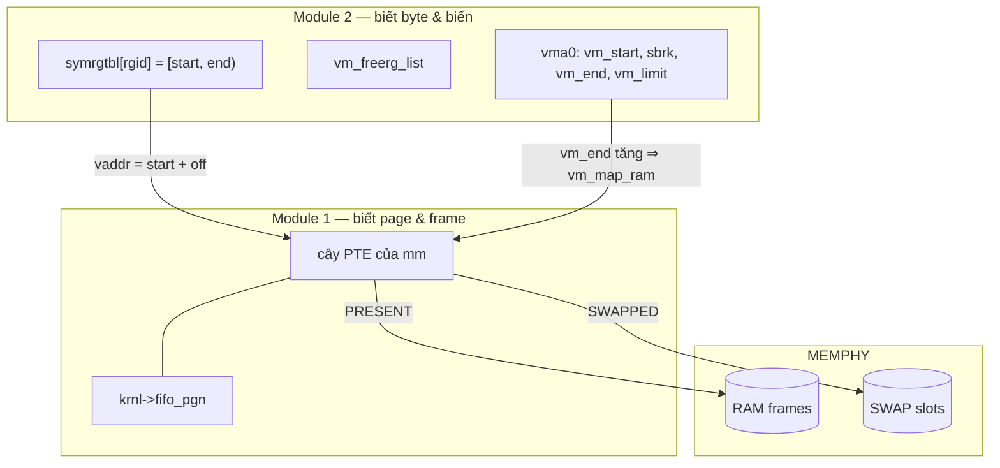

# 04 — Virtual Memory và User Memory API

> Tiên quyết: `03` §4 (layout), §7 (translation), §9 (replacement). Ký hiệu như `01`.
> File này tập trung vào tầng **phía trên** paging: "biến" (region) nằm ở đâu trong không
> gian ảo, và cấp/giải phóng chúng thế nào. Cơ chế page/frame/swap không lặp lại ở đây.

---

## 1. WHY — tại sao cần thêm tầng region/VMA trên paging?

Paging chỉ biết **page 4 KiB**. Nhưng chương trình xin bộ nhớ theo **byte** (`alloc 300`).
Nếu mỗi `alloc` chiếm trọn một page thì lãng phí; nếu không ghi nhớ ranh giới thì không kiểm
tra được truy cập vượt biên. Vì vậy có hai tầng quản lý:

| Tầng | Đơn vị | Câu hỏi | Struct |
|---|---|---|---|
| Region (biến) | byte | "Biến số 1 ở `[0x1000, 0x1064)`" | `vm_rg_struct` trong `symrgtbl[]` |
| Free region | byte | "Khoảng `[0x1064, 0x112C)` còn trống" | `vm_rg_struct` trong `vm_freerg_list` |
| VMA (area) | page | "Vùng `[vm_start, vm_end)` đã có frame; được phép lớn tới `vm_limit`" | `vm_area_struct` |
| Page/PTE | page | "Page 1 ở frame 0" | cây page table (`03`) |

Đây chính là ý tưởng **segmentation + paging** mà spec hỏi (§2.2.2): VMA cho cái nhìn liên tục,
có giới hạn (như segment); paging lo phần ánh xạ rời rạc xuống frame.

---

## 2. Virtual address space của một process

### 2.1 Những gì thực sự tồn tại **[V]**
Sau `init_mm(proc->mm, proc)` (`mm64.c:843`), mỗi process có **đúng một VMA — vma0**:

```
0x0000_0000_0000_0000 ┌────────────────────────────┐
                      │ page 0: __PAGEZERO (không   │  truy cập ⇒ lỗi
0x0000_0000_0000_1000 ├────────────────────────────┤ ← vm_start (vma0)
                      │ region, free region ...     │  đã có frame
                sbrk ─┤ (đỉnh phần đã cấp cho biến) │
                      │ đuôi trống của page cuối    │
              vm_end ─├────────────────────────────┤  (luôn bội số 4096)
                      │ chưa map, được phép mở rộng │
                      │            ...              │
0x00FF_FFFF_FFFF_FFFF └────────────────────────────┘ ← vm_limit (cuối nửa user)
          (khoảng non-canonical)
0xFF00_0000_0000_0000 ┌────────────────────────────┐ ← kernel (os.mm, xem 05)
```

Bất biến: `vm_start ≤ sbrk ≤ vm_end ≤ vm_limit + 1`; `[vm_start, vm_end)` đều đã map;
`vm_end` căn 4 KiB. **[C]**

### 2.2 Không tồn tại (dù spec gợi ý)
- Không có stack, code, data segment riêng; không có nhiều VMA (dù `vm_next` và `vmaid` có sẵn).
- Không có layout kiểu macOS chia vùng small/medium/large (spec §2.2.1 "encourage"). Chỉ có
  điểm chung với macOS là **`__PAGEZERO`** ở page 0. **[C]**
- `Document/Memory_layout.md` mô tả layout 47-bit (`0x0000_7FFF…`, `0xFFFF_8000…`) — **đã lỗi thời**;
  code dùng 57-bit (`mm64.h:12-15`).

---

## 3. Region và symbol table

- `mm->symrgtbl[30]` (`os-mm.h:138`): "symbol table" đơn giản — chỉ số = **region ID** = toán hạng
  "register" của instruction (`01` §6.2).
- Region chưa cấp: `rg_start == rg_end == 0`. Vì page 0 không bao giờ map, `rg_start == 0`
  không thể là region thật ⇒ an toàn làm cờ "trống".
- `get_symrg_byid(mm, rgid)` (`libmem.c:55`): kiểm `0 ≤ rgid < 30`, trả con trỏ.

---

## 4. Allocation — `liballoc` → `__alloc` (`libmem.c:71-172`)

### 4.1 Thuật toán
```
lock mmvm_lock
vma = get_vma_by_num(mm, 0); kiểm rgid, size != 0
# Đường A — tái dùng: first-fit trong vm_freerg_list
if get_free_vmrg_area(size) thành công:
    symrgtbl[rgid] = region tìm được; sbrk = max(sbrk, rg_end); return 0
# Đường B — mở rộng tại sbrk
old_sbrk = sbrk; next_brk = old_sbrk + size        (kiểm không vượt vm_limit / tràn số)
syscall 17 SYSMEM_INC_OP(vmaid, size)               ← handler inc_vma_limit là STUB, không làm gì
if vm_end < next_brk:
    map_start = vm_end
    n = PAGE_ALIGN(next_brk - map_start) / 4096
    vm_map_ram(caller, vm_start, map_start + n·4096, map_start, n)   ← Module 1; lỗi ⇒ return -1
    nếu đuôi trống cũ [old_sbrk, map_start) có trong free list: đánh dấu đã dùng (start = end)
    vm_end = map_start + n·4096
    nếu next_brk < vm_end: thêm free region [next_brk, vm_end)
sbrk = next_brk; symrgtbl[rgid] = [old_sbrk, next_brk)
unlock; return 0
```
`liballoc` (`:219`) gọi `__alloc` với `vmaid = 0`, rồi `print_pgtbl` (bật `PAGETBL_DUMP`).

### 4.2 `get_free_vmrg_area` (`libmem.c:1701-1759`) — first fit
Duyệt free list; region đầu tiên đủ lớn được cắt từ **đầu**. Nếu dùng hết region: chép nội dung
node kế tiếp vào node hiện tại và free node kế (hoặc để lại node rỗng nếu là cuối danh sách).

### 4.3 Trace có số liệu — `p0s` (PID 1 trong `os_0_mlq_paging`) **[V]**

| Lệnh | Đường | Region được gán | sbrk | vm_end | Free list (đầu → cuối) | PTE |
|---|---|---|---|---|---|---|
| (init) | | | 0x1000 | 0x1000 | `[0x1000,0x1000)` | ∅ |
| `alloc 300 0` | B | r0 = `[0x1000,0x112C)` | 0x112C | 0x2000 | `[0x112C,0x2000)` → `[0x1000,0x1000)` | p1→F0 |
| `alloc 300 4` | A | r4 = `[0x112C,0x1258)` | 0x1258 | 0x2000 | `[0x1258,0x2000)` → `[0x1000,0x1000)` | — |
| `free 0` | | r0 = 0 | 0x1258 | 0x2000 | `[0x1000,0x112C)` → `[0x1258,0x2000)` → `[0x1000,0x1000)` | — |
| `alloc 100 1` | A | r1 = `[0x1000,0x1064)` | 0x1258 | 0x2000 | `[0x1064,0x112C)` → `[0x1258,0x2000)` → … | — |
| `write 100 1 20` | | vaddr 0x1014 → paddr 20 | | | | log `IO_WRITE addr=20` |

Quan sát: chỉ lệnh đầu tiên tạo dòng `[SYSCALL] … INC` trong log; các lệnh sau dùng đường A
(không syscall). Node rỗng `[0x1000,0x1000)` do `init_mm` tạo nằm mãi trong danh sách — vô hại.

### 4.4 Ví dụ đường B vắt qua ranh giới page (tính tay từ code) **[C]**
Từ trạng thái sau `alloc 300 4` ở trên, giả sử `alloc 4000 7`:
- First-fit: `[0x1258,0x2000)` chỉ còn 3496 B < 4000 ⇒ đường B.
- `old_sbrk = 0x1258`, `next_brk = 0x21F8`, `vm_end = 0x2000 < next_brk`.
- `map_start = 0x2000`, `n = ALIGN(0x1F8)/4096 = 1` ⇒ map page 2.
- Đuôi cũ `[0x1258,0x2000)` khớp `[old_sbrk, map_start)` ⇒ đánh dấu đã dùng.
- `vm_end = 0x3000`; thêm free `[0x21F8,0x3000)`; r7 = `[0x1258,0x21F8)` (vắt 2 page).
⇒ Region **liên tục về mặt ảo** dù page 1 và page 2 có thể ở hai frame xa nhau.

---

## 5. Free — `libfree` → `__free` (`libmem.c:181-212`)

```
lock; kiểm rgid; region trống (0,0) ⇒ -1 (bắt free 2 lần)
node mới = bản sao [rg_start, rg_end); xóa symrgtbl[rgid]
enlist_vm_freerg_list(mm, node)     # thêm vào ĐẦU free list của mm->mmap (vma0)
unlock
```
- **Không** trả frame, **không** unmap, **không** gộp (coalesce) các khoảng kề nhau ⇒ free list
  có thể phân mảnh theo thời gian; nhưng frame không bao giờ "thủng". Đây là lựa chọn của spec. **[C]**
- `malloc` không kiểm NULL (`:199`). **[C]**
- `libfree` in dòng debug `libfree:251` (`:251`) — thấy trong mọi log. **[V]**

---

## 6. Read và write — `libread`/`libwrite` → `__read`/`__write`

### 6.1 Chuỗi kiểm tra (`libmem.c:456-493`, `:526-565`) **[V]**
1. `caller`, `mm` hợp lệ; khóa `mmvm_lock`.
2. Region tồn tại (`rg_start != 0`, `rg_start < rg_end`) — sai ⇒ in `Lỗi Bảo Mật: Vùng nhớ (rgid=N) không hợp lệ`.
3. `offset < rg_end − rg_start` — sai ⇒ `Offset vượt quá giới hạn vùng nhớ`
   (ví dụ `write 1 2 1000` trong `m0s`: region 2 chỉ 100 B).
4. `vaddr = rg_start + offset` phải ∈ `[USER_SPACE_START, USER_SPACE_END]` — chặn page 0 và kernel.
5. `pg_getval` / `pg_setval` (`:369`, `:412`): `pg_getpage` (có thể swap-in) → `paddr = fpn·4096 + off`
   → **syscall 17** `SYSMEM_IO_READ` / `SYSMEM_IO_WRITE` → `MEMPHY_read/write(mram, paddr)`.
6. READ: giá trị trả qua `regs.a3`, `cpu.c` ghi vào `proc->regs[arg_2]` nếu `arg_2 < 10`.

Kiểm tra theo **region**, không chỉ theo VMA ⇒ truy cập vào phần "đuôi trống" của page (đã map
nhưng chưa cấp cho biến nào) vẫn bị từ chối. Chặt hơn phần cứng thật (phần cứng chỉ kiểm page). **[C]**

### 6.2 Vì sao đọc/ghi một byte lại đi qua syscall?
Theo spec (Figure 7), MEMPHY là "phần cứng" chỉ kernel chạm được; thư viện user nhờ kernel bằng
`SYSMEM_IO_*`. Code tuân theo đúng điều đó: mỗi byte = một lời gọi `_syscall` + một lần tra PCB
theo PID. Chi phí cao nhưng đúng mô hình phân quyền. **[V]**

---

## 7. Page fault handling trong simulator

| Lý thuyết | Simulator |
|---|---|
| MMU tra TLB/page table, gặp PTE invalid ⇒ trap | `pg_getpage` tự tra cây bằng phần mềm |
| Kernel xử lý trap, nạp page, retry instruction | `pg_getpage` swap-in đồng bộ rồi trả `fpn` ngay; không có retry |
| Page chưa map ⇒ SIGSEGV | `pg_getpage` trả -1 ⇒ lệnh lỗi, process vẫn chạy tiếp |
| Demand paging (map lười khi chạm lần đầu) | **Không**: `alloc` map frame **ngay lập tức** (eager) |

Như vậy "page fault" duy nhất được mô phỏng là **major fault của page đã bị swap-out**. Chi tiết
thuật toán: `03` §9.4. **[V]**

---

## 8. Quan hệ virtual memory ↔ physical memory


- VM quyết định **địa chỉ ảo nào hợp lệ**; paging quyết định **page nằm ở đâu**.
- VM gọi xuống paging ở đúng 2 chỗ: `vm_map_ram` (khi `vm_end` tăng) và `pg_getpage` (khi đọc/ghi).
- Paging không bao giờ gọi ngược lên VM.

---

## 9. Spec vs implementation và các gap của Module 2

| Mục | Spec (Figure 7) | Code | Mức độ |
|---|---|---|---|
| Mở rộng vùng | `SYSCALL MEMINC` → `inc_vma_limit` → `vm_map_ram` | Syscall được gọi nhưng `inc_vma_limit` **trả 0 không làm gì** (`mm-vm.c:136-152`); map thực hiện trực tiếp trong `__alloc` | Lệch kiến trúc, chức năng vẫn đúng **[V]** |
| `get_vma_by_num` | trả NULL nếu không thấy | Dereference `pvma->vm_id` sau khi `pvma` có thể đã NULL (`mm-vm.c:37-44`) ⇒ crash nếu `vmaid ≥ 1` với 1 VMA. Hiện mọi lời gọi dùng `vmaid = 0` nên chưa lộ | Bug tiềm ẩn **[C]** |
| Overlap check | `validate_overlap_vm_area` | Macro `OVERLAP` = `(0)` (`mm.h:123-124`) ⇒ không bao giờ phát hiện | Stub **[C]** |
| `get_vm_area_node_at_brk` | trả region mới | Trả con trỏ chưa khởi tạo (warning khi build); không ai gọi | Code chết **[V]** |
| Free list theo vmaid | — | `enlist_vm_freerg_list` luôn dùng `mm->mmap` (vma0) | Đúng khi chỉ 1 VMA |
| Register giữ địa chỉ | `alloc` ghi `regs[reg]` | Ghi `symrgtbl[reg]` | Diễn giải lại **[V]** |
| Coalesce free region | không yêu cầu | Không làm | — |

---

## 10. Trace ngắn 4 thao tác (tham chiếu `06` để có log đầy đủ)

| Thao tác | Chuỗi gọi |
|---|---|
| alloc | `run` → `liballoc` → `__alloc` → [`get_free_vmrg_area`] / [`_syscall(INC)` → `__sys_memmap` → `inc_vma_limit` (no-op); `vm_map_ram` → `prepare_pages`, `alloc_pages_range`, `map_prepared`] → `print_pgtbl` |
| write | `run` → `libwrite` → `__write` → `pg_setval` → `pg_getpage` → `_syscall(IO_WRITE)` → `MEMPHY_write` |
| read | `run` → `libread` → `__read` → `pg_getval` → `pg_getpage` → `_syscall(IO_READ)` → `MEMPHY_read` → `regs[dst]` |
| free | `run` → `libfree` → `__free` → `enlist_vm_freerg_list` |

---

## Active recall

1. Phân biệt 4 tầng: region, free region, VMA, PTE. Mỗi tầng tính theo đơn vị gì?
2. `sbrk` và `vm_end` khác nhau thế nào? Khi nào `sbrk < vm_end`?
3. Vì sao `rg_start == 0` dùng được làm cờ "region trống"?
4. Trong `__alloc`, khi nào đi đường A, khi nào đường B? Đường nào sinh dòng `INC` trong log?
5. Handler `SYSMEM_INC_OP` làm gì? Vậy ai thật sự map frame mới?
6. `free` có trả frame không? Nếu không, frame được trả khi nào?
7. Liệt kê 4 kiểm tra của `__write` trước khi chạm bộ nhớ.
8. Simulator có demand paging không? Có page fault không? Phân biệt.
9. Bug nào trong `get_vma_by_num` và vì sao chưa lộ?

## Bài tập nhỏ

1. Tiếp bảng §4.3 với các lệnh còn lại của `p0s` (`write 102 2 20`, …, `free 4`). Lệnh nào lỗi, vì sao?
2. Viết bảng trạng thái cho `m1s` (alloc 300 0, alloc 100 1, free 0, alloc 100 2, free 2, free 1). Free list cuối cùng có bao nhiêu node?
3. Chỉ ra trong code vì sao `alloc 0 3` thất bại.
