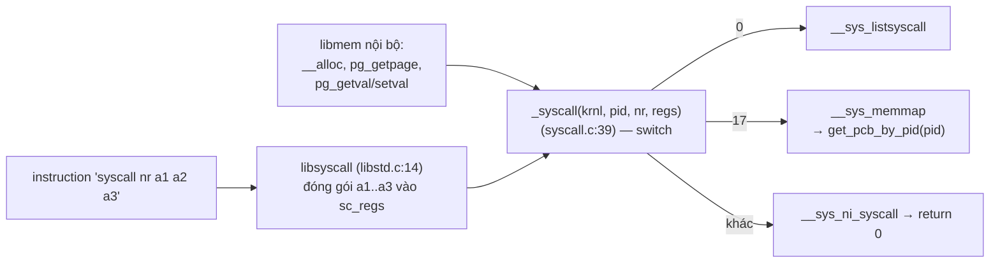
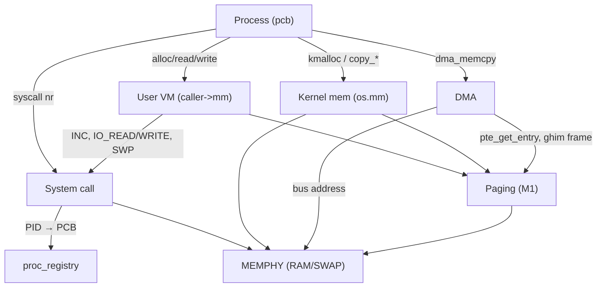

# 05 — Kernel Memory, System Call và DMA

> Tiên quyết: `01`, `03` §2 (MEMPHY), §8 (PTE API), `04` §6. Ký hiệu như `01`.
> Ba subsystem này là "keo dán": chúng không thêm thuật toán bộ nhớ mới, mà thêm **ranh giới
> bảo vệ** (user ↔ kernel) và **tính bất đồng bộ** (CPU ↔ DMA).

---

## Phần A — Kernel memory

### A.1 WHY — simulator cần kernel memory để làm gì?
Spec §2.2.1 yêu cầu: user đọc/ghi được user space, **không** được chạm kernel space; muốn trao
đổi dữ liệu phải qua `copy_from_user`/`copy_to_user`. Để có ranh giới đó, phải có một vùng nhớ
"thuộc kernel" thật sự. Ngoài ra `kmalloc` phải trả về bộ nhớ **liên tục về mặt vật lý** — kiểu
bộ nhớ mà phần cứng (như DMA) cần.

**Thực tế quan trọng khi bảo vệ:** các cấu trúc dữ liệu của chính OS (PCB, queue, page table,
registry) **không** nằm trong kernel memory mô phỏng — chúng nằm trong heap host. Kernel memory
ở đây là một **pool mà process xin qua `kmalloc`** để làm buffer kernel. **[C]**

### A.2 WHAT — kernel address space

| Thành phần | Giá trị | Nguồn |
|---|---|---|
| `os.mm` | một `mm_struct` duy nhất, dùng chung cho mọi process | `os.c:441-445` |
| vma0 kernel | `vm_start = 0xFF00_0000_0000_0000`, `vm_limit = 0xFFFF…FF` | `init_mm(os.mm, NULL)` |
| Cây page table | PGD index 256–511 | `03` §4 |
| `os.krnl_pgd` | **alias** của `os.mm->pgd`, không cấp/giải phóng riêng | `os.c:448` |
| Symbol table | `os.mm->symrgtbl[30]` — **30 slot cho toàn hệ thống** | `os-mm.h:138` |
| `pcb->kmap_slot[30]` | "kernel region ID của process" → slot trong `os.mm->symrgtbl`; -1 = trống | `common.h:153` |
| Khóa | `kmm_lock` | `libmem.c:27` |

Mental model: **kernel region ID là "file descriptor"** — mỗi process có bảng số nhỏ riêng
(`kmap_slot`), trỏ vào một bảng chung của kernel. Hai process cùng dùng kernel ID 5 sẽ trỏ tới hai
slot khác nhau. **[V]** (`test_two_processes` trong `run_kmem_tests.sh`).

Hệ quả: user region ID và kernel region ID là **hai không gian số riêng biệt** — `alloc 100 5`
và `kmalloc 64 5` không đụng nhau. Program mẫu `m2s` nhầm điều này nên nhiều lệnh lỗi (xem `06` §9).

### A.3 HOW — `__kmalloc(caller, vmaid, rgid, size, &addr)` (`libmem.c:671-779`)
```
kiểm tham số; aligned = PAGE_ALIGN(size); n = aligned / 4096
lock kmm_lock
1. kmap_slot[rgid] phải == -1
2. tìm kslot trống trong os.mm->symrgtbl (rg_start == rg_end == 0)
3. chọn VA (CHƯA commit):
     a) first-fit trong free list kernel (vùng đã __kfree), căn 4 KiB, ≥ KERNEL_SPACE_START
     b) không có ⇒ VA = PAGE_ALIGN(sbrk) của kernel vma0
4. MEMPHY_get_freefp_range(mram, n) → n frame LIÊN TIẾP (all-or-nothing)
5. pte_set_fpn(os.mm, pgn_i, fpn + i) cho i = 0..n-1
   lỗi giữa chừng ⇒ xóa PTE đã ghi, trả MỌI frame, return -1
6. commit: cập nhật hole hoặc sbrk/vm_end; symrgtbl[kslot] = [VA, VA + size) (biên CHÍNH XÁC theo byte)
   kmap_slot[rgid] = kslot; *addr = VA
unlock
```
Khác với user page:
- Frame **liên tục** (user page lấy frame lẻ).
- **Không** vào FIFO ⇒ **không bao giờ bị swap**.
- Không đi qua syscall.

Ví dụ thật (`study_kd`, `06` §8): user region dùng frame 0; `kmalloc 64 5` ⇒ VA `0xFF00_0000_0000_0000`,
1 page, frame 1 (frame trống đầu tiên). Copy thành công được **[V]** bằng log; còn số frame 1 là
**[I]** (ghi kernel đi thẳng vào MEMPHY nên không có log; suy ra vì user đang giữ frame 0).

### A.4 `__kfree(caller, vmaid, rgid)` (`libmem.c:781-836`)
Với từng page: `pte_get_entry(os.mm)` → `MEMPHY_put_freefp(mram, fpn)` → `pte_clear_entry`.
Trả dải ảo `[start, start + aligned)` về free list kernel, xóa slot, `kmap_slot[rgid] = -1`.
Được gọi tự động cho mọi kernel region còn lại khi process kết thúc (`os.c:357-360`).
**Không có instruction `kfree`** trong loader ⇒ user không tự giải phóng kernel region được. **[C]**

### A.5 `copy_from_user` / `copy_to_user` (`libmem.c:1198-1317`)
```
kiểm: cả hai region tồn tại; nguồn ∈ user space, đích ∈ kernel space (hoặc ngược lại);
      offset + size vừa CẢ HAI region            ← kiểm toàn bộ TRƯỚC byte đầu tiên
for i in 0..size-1:
    from_user: __read_user_mem(src, off+i)  →  __write_kernel_mem(dst, off+i)
    to_user  : __read_kernel_mem(src, off+i) →  __write_user_mem(dst, off+i)
```
| Hàm phụ | Khóa | Dịch địa chỉ | Có swap? | Có syscall? |
|---|---|---|---|---|
| `__read_user_mem` / `__write_user_mem` (`:1468`, `:1512`) | `mmvm_lock` | `pg_getval/setval` trên `caller->mm` | Có | Có (`IO_*`) |
| `__read_kernel_mem` / `__write_kernel_mem` (`:1327`, `:1398`) | `kmm_lock` | `pte_get_entry(os.mm)` | Không (kernel luôn PRESENT) | **Không** (gọi `MEMPHY_*` trực tiếp) |

Nhận xét: khóa được lấy/nhả **từng byte**, không giữ suốt lần copy ⇒ copy không nguyên tử đối với
các thread khác (một CPU khác có thể ghi xen giữa). Không có `kmm_lock` lồng `mmvm_lock` ⇒ không
deadlock. **[C]**

### A.6 User/kernel separation thực sự được thực thi ở đâu?
1. **Address space khác nhau:** READ/WRITE chỉ tra `caller->mm`; kernel page nằm ở cây `os.mm`.
2. **ID space khác nhau:** READ/WRITE dùng `caller->mm->symrgtbl`, không thể gọi tên kernel region.
3. **Kiểm dải địa chỉ:** `__read/__write` từ chối `vaddr ∉ [0x1000, 0x00FF…FF]` (`libmem.c:482`, `:553`).
4. Không có mode bit phần cứng — tất cả là kiểm tra phần mềm. **[C]**

**Lỗ hổng cần biết (để chủ động nói khi bị hỏi):** user program có thể gọi thẳng
`syscall 17 5 <paddr> <value>` (`SYSMEM_IO_WRITE`) — `__sys_memmap` chỉ kiểm PID tồn tại rồi ghi vào
**địa chỉ vật lý bất kỳ**, kể cả frame kernel. Tương tự `IO_READ`. **[C]** (đọc code `sys_mem.c:97-105`, chưa chạy thử).

---

## Phần B — System call

### B.1 WHY
Spec §1.6.2: syscall là **cổng duy nhất** từ user vào kernel. Hai lợi ích chính trong simulator:
(1) kernel nhận **PID** chứ không nhận con trỏ PCB ⇒ user không đưa được PCB giả; (2) mọi thao tác
chạm "phần cứng" (MEMPHY) được tập trung một chỗ.

### B.2 Interface và dispatch **[V]**


**Bảng syscall được sinh tự động** (kỹ thuật X-macro):
1. `src/syscall.tbl`: `0 listsyscall sys_listsyscall`, `17 memmap sys_memmap`.
2. `make` chạy `src/syscalltbl.sh` ⇒ `src/syscalltbl.lst`: `__SYSCALL(0, sys_listsyscall)` …
3. `syscall.c` `#include "syscalltbl.lst"` **3 lần** với 3 định nghĩa `__SYSCALL` khác nhau:
   khai báo `extern` handler, mảng tên `sys_call_table[]`, và các `case` trong `switch`.

Thêm syscall mới = thêm dòng vào `.tbl` + file `sys_xxx.c` + thêm object vào `SYSCALL_OBJ`
(spec §1.6.3). **Repo hiện chưa có syscall 440 / 101** dù `sc3`/`sc2` gọi chúng ⇒ rơi vào
`__sys_ni_syscall` và **trả 0 lặng lẽ** (không lỗi, không in gì) — thấy trong log `os_syscall`. **[V]**

### B.3 `__sys_memmap` (`sys_mem.c:44-113`)

| `a1` | Tên | `a2` | `a3` | Handler | Ai gọi trong code |
|---|---|---|---|---|---|
| 1 | `SYSMEM_MAP_OP` | addr | số page | `vmap_pgd_memset` | chỉ user `syscall 17 1 …` |
| 2 | `SYSMEM_INC_OP` | vmaid | size | `inc_vma_limit` (**stub**) | `__alloc` đường B |
| 3 | `SYSMEM_SWP_OP` | victim FPN | swap FPN | `__mm_swap_page` → `__swap_cp_page` | `pg_getpage` |
| 4 | `SYSMEM_IO_READ` | paddr | ← giá trị | `MEMPHY_read(mram)` | `pg_getval` |
| 5 | `SYSMEM_IO_WRITE` | paddr | giá trị | `MEMPHY_write(mram)` | `pg_setval` |

Mỗi lần vào: `get_pcb_by_pid` khóa `registry_lock`, quét `proc_registry[128]` (O(128)). PID không
tồn tại ⇒ `[Kernel Error] … invalid PID` và -1. Có thể có vì process bị gỡ registry trước khi dọn
dẹp (`os.c:347-354`). **[C]**

Thứ tự khóa thực tế: `mmvm_lock` → (`_syscall`) → `registry_lock`. `Document/API_CONTRACT.md` §5.2
vẽ `registry_lock → mmvm_lock` — ngược với code, nhưng không gây deadlock vì không có chỗ nào giữ
`registry_lock` rồi xin `mmvm_lock`. **[C]**

### B.4 Syscall thực sự được dùng ở đâu? (đếm từ log thật)
Trong `os_0_mlq_paging`, gần như **mọi** dòng `[SYSCALL]` đến từ thư viện bộ nhớ (INC, IO_READ,
IO_WRITE), không phải từ instruction `syscall`. Mỗi byte đọc/ghi = 1 syscall. Đây là điểm đáng nói
khi trả lời câu hỏi spec về **unified system call interface** (xem `07`).

---

## Phần C — DMA

### C.1 WHY
Không có DMA, chép N byte = CPU tự đọc rồi ghi N lần (programmed I/O), và CPU bận suốt thời gian đó.
DMA: CPU chỉ mô tả *nguồn, đích, độ dài* rồi đi làm việc khác; co-processor chép và báo xong bằng
interrupt (spec §2.3). Spec chấm 3 điểm cho phần này: 1 điểm bất đồng bộ, 1 điểm CPU truy cập qua MMU,
1 điểm co-processor truy cập bộ nhớ qua bus address.

### C.2 Ánh xạ khái niệm → code

| Khái niệm spec | Hiện thực |
|---|---|
| CPU "lập trình" DMA | `libmem_dma_memcpy` (`libmem.c:1122`) dịch VA → PA rồi `dma_submit` |
| Bus address | Địa chỉ **vật lý** = offset trong `mram.storage`; RAM được gắn làm bank 0 (`memory_bank_attach`, `os.c:694`) |
| DMA controller | RTL `dma_top` (Verilog → Verilator), điều khiển bởi `dpi_rtl_dma_copy` (`dpi_rtl.cpp:80`) |
| DMA truy cập bộ nhớ | DPI callback `dpi_bank_read32_legacy` / `dpi_bank_write32_legacy` (`sysbus.c:185`, `:205`) |
| Interrupt hoàn tất | DPI `dma_done_callback` (in `DMA completed`) + callback phần mềm `dma_unpin_cb` |
| Chạy song song CPU | Thread `dma_worker` (`os.c:202`), không gắn timer |

### C.3 Pipeline **[V]**

```mermaid
sequenceDiagram
    autonumber
    participant CPU as CPU thread (run)
    participant LM as libmem_dma_memcpy
    participant PIN as dma_pin_count[]
    participant Q as hàng đợi (os.c)
    participant W as dma_worker
    participant RTL as do_dma → RTL
    participant BUS as sysbus (bank 0 = RAM)

    CPU->>LM: dma_memcpy src dst off size
    LM->>LM: lock mmvm_lock; kiểm region & biên
    loop cắt tại mọi ranh giới page của nguồn VÀ đích
        LM->>LM: dma_vtop: pte_get_entry → phải PRESENT (không swap-in!)
        LM->>LM: gộp đoạn nếu liên tục vật lý cả 2 phía
        LM->>PIN: ghim các frame của run
    end
    LM->>LM: unlock
    LM->>Q: dma_submit(pid, src_pa, dst_pa, len, dma_unpin_cb) × số run
    LM-->>CPU: return 0 NGAY (dữ liệu CHƯA được chép)
    Note over CPU: CPU chạy lệnh tiếp theo
    W->>Q: lấy yêu cầu
    W->>RTL: do_dma: kiểm biên, không chồng lấn
    RTL->>BUS: phần bội số 4 byte: RTL đọc/ghi 32-bit qua DPI
    RTL-->>W: ch_done ("DMA completed")
    W->>W: 1–3 byte đuôi: memcpy bằng phần mềm
    W->>PIN: dma_unpin_cb (bỏ ghim)
    W->>Q: pending--, broadcast dma_finished
```

### C.4 Các quyết định thiết kế đáng nhớ
1. **Ghim frame** (`dma_pin_count[65536]`, `libmem.c:899`): page replacement bỏ qua frame bị ghim
   (`mm64_fifo_victim` gọi `dma_frame_pinned`). Không có ghim, FIFO có thể đẩy page ra swap rồi giao
   frame cho process khác trong khi RTL vẫn đang ghi vào đó. **[V]** (`test_skip_pinned`).
2. **Chờ khi process kết thúc** (`dma_process_exit`, `os.c:179`): bước dọn dẹp đầu tiên chờ mọi
   yêu cầu của PID xong rồi mới trả frame. Đây là nơi **duy nhất** CPU chờ DMA.
3. **Đuôi 1–3 byte** (`dma_c_testbench.cpp:128-146`): RTL chép theo word 32-bit; nhóm đo được rằng
   chiều dài lẻ khiến RTL ghi lố tối đa 3 byte sau đích, nên chỉ đưa phần bội số 4 cho RTL.
   Hệ quả: `dma_memcpy … 2` **không chạy RTL chút nào** (không có dòng `DMA completed`); `… 10` chạy RTL
   8 byte + memcpy 2 byte. **[V]** (`06` §8).
4. **Chỉ user region, chỉ page đang ở RAM:** region kernel không dùng được; page đang ở swap ⇒ lệnh
   thất bại (`page N is not in RAM`) chứ không swap-in. **[C]**
5. Không có build `USE_DMA` ⇒ `dma_submit` trả -1 (`os.c:291`), lệnh bị từ chối. **[C]**

### C.5 Vấn đề đồng bộ còn mở **[I]**
RTL ghi thẳng vào `mram.storage` qua `memory_bank_get_ptr`, **không** lấy `memphy_lock`. Ghim chỉ
ngăn frame bị **thu hồi**, không ngăn process khác (hoặc chính process) `write` vào cùng byte trong
lúc DMA chạy ⇒ có thể data race ở mức byte. Phù hợp với mô hình phần cứng thật (DMA không đi qua
lock của OS) nhưng nên nêu như một limitation.

---

## Phần D — Ba subsystem liên hệ với process và memory management thế nào



| Subsystem | Giải quyết vấn đề gì | Dùng thực sự ở đâu |
|---|---|---|
| Kernel memory | Ranh giới user/kernel; bộ nhớ liên tục, không swap | `kmalloc`, `copy_*`, dọn dẹp khi exit |
| System call | Cổng vào kernel bằng PID; tập trung truy cập MEMPHY | Mọi byte đọc/ghi user, mở rộng vùng, swap-in; `listsyscall` |
| DMA | Chép dữ liệu bất đồng bộ không chiếm CPU | `dma_memcpy`; ghim frame ảnh hưởng page replacement; exit chờ DMA |

---

## Active recall

1. Kernel memory trong simulator có chứa PCB hay page table không? Vậy nó dùng để làm gì?
2. Vì sao `kmap_slot` cần thiết? Giới hạn số kernel region của **toàn hệ thống** là bao nhiêu?
3. Ba khác biệt giữa frame của `kmalloc` và frame của user `alloc`.
4. `__write_kernel_mem` có đi qua syscall không? `__write_user_mem` thì sao? Tại sao khác nhau?
5. Giải thích kỹ thuật X-macro sinh bảng syscall từ `syscall.tbl`.
6. Gọi `syscall 440 1` thì chuyện gì xảy ra? Có lỗi không?
7. Mô tả lỗ hổng của `SYSMEM_IO_WRITE` khi user gọi trực tiếp.
8. Vì sao phải ghim frame khi DMA? Nếu không ghim thì kịch bản lỗi cụ thể là gì?
9. `dma_memcpy 1 2 0 2` có chạy RTL không? `… 0 10` thì sao?
10. CPU chờ DMA ở đúng một chỗ — chỗ nào, và tại sao chỉ ở đó?

## Bài tập nhỏ

1. Viết lại `m2s` (trong bản copy `/tmp`) sao cho mọi lệnh đều thành công. Gợi ý: phân biệt user ID và kernel ID, `kmalloc` trước `copy_*`.
2. Vẽ sơ đồ trạng thái của một yêu cầu DMA: *queued → running → done/failed → unpinned*.
3. Liệt kê mọi khóa được lấy trong một lần `copy_from_user` 3 byte, theo đúng thứ tự thời gian.
